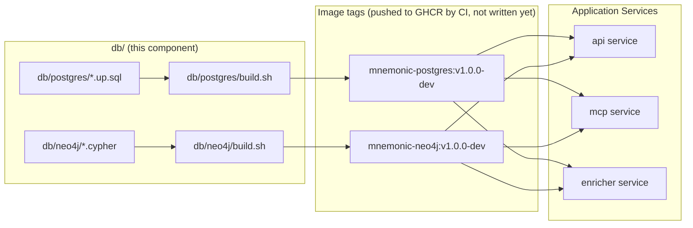

# Database Images — Architecture Overview

> Back to [Database Architecture](README.md) | [Design Index](../../README.md)

## Table of Contents

- [Introduction](#introduction)
- [Core Concept](#core-concept)
- [System Model](#system-model)
- [Key Principles](#key-principles)
- [Document Navigation](#document-navigation)

## Introduction

The `db/` component owns the database schema and pre-seeded Docker images for the Mnemonic project. It produces two images — `mnemonic-postgres` and `mnemonic-neo4j` — that application services pull directly instead of running migrations at startup.

The component is intentionally decoupled from the application code, even though it sits in the same monorepo. Schema changes are made in `db/`, tested, built into new image tags, and consumed by the mcp, api and enricher services by updating their image references. Today the compose files and the Helm chart pin `ghcr.io/twistingmercury/mnemonic-postgres:v1.0.0-dev` and `ghcr.io/twistingmercury/mnemonic-neo4j:v1.0.0-dev`. This gives schema changes their own lifecycle: reviewed, tested, and versioned independently.

## Core Concept

## System Model

| Component                | Description                                                                   |
| ------------------------ | ----------------------------------------------------------------------------- |
| `db/postgres/`           | SQL schema files (`*.up.sql`) and Dockerfile for the Postgres image           |
| `db/neo4j/`              | Cypher schema files and Dockerfile/build script for the Neo4j image           |
| `db/tests/`              | BATS test suites and test runner scripts that verify schema correctness       |
| `db/docker-compose.yaml` | Local test infrastructure (isolated ports, not used by application services)  |
| CI workflow              | Not written yet; see [Deployment Architecture](05-deployment-architecture.md) |

## Key Principles

1. **Schema owns its own lifecycle** — changes to the database schema ship as new image tags, reviewed and tested independently of application code.
2. **Self-initializing images** — containers apply the schema when they start (Postgres on first start with an empty data directory, Neo4j on every start) with no external tooling required at runtime.
3. **No runtime migration tooling** — application services do not run migrations at startup; they pull images that are already initialized.
4. **Tested before shipped** — BATS tests verify the schema state after initialization runs; image publishing is meant to be gated on those tests once the CI workflows exist.
5. **Community Edition only** — both images target freely available database editions (pgvector community, Neo4j Community Edition) to avoid licensing constraints.

## Document Navigation

| #   | Document                                                 | Description                           | Status  |
| --- | -------------------------------------------------------- | ------------------------------------- | ------- |
| 00  | [Overview](00-overview.md)                               | This document                         | Current |
| 02  | [Architectural Decisions](02-architectural-decisions.md) | ADR log                               | Current |
| 05  | [Deployment Architecture](05-deployment-architecture.md) | Image build; CI/CD (not written yet)  | Current |
| 08  | [Data Architecture](08-data-architecture.md)             | PostgreSQL and Neo4j schema reference | Current |

**Next:** [Architectural Decisions](02-architectural-decisions.md)

---

Copyright (c) 2025-2026 Jeremy K. Johnson. Licensed under FSL-1.1-ALv2; see [LICENSE](../../../../LICENSE).
