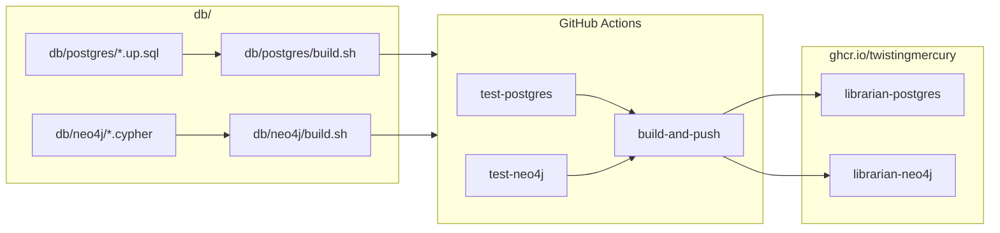

# Database Images — Deployment Architecture

> Back to [Database Architecture](README.md) | [Design Index](../../README.md)

## Table of Contents

- [Deployment Overview](#deployment-overview)
- [Image Build Pipeline](#image-build-pipeline)
- [CI/CD Workflow](#cicd-workflow)
- [Image Tagging Strategy](#image-tagging-strategy)
- [Updates and Rollbacks](#updates-and-rollbacks)

## Deployment Overview

The `db/` component does not deploy running services. Its output is two Docker images pushed to GitHub Container Registry (GHCR). Application services pull these images and run them as database containers.



## Image Build Pipeline

### librarian-postgres

Built with a standard `docker build`. The `Dockerfile` is in `db/postgres/`:

1. `FROM pgvector/pgvector:pg16`
2. Sets `POSTGRES_DB`, `POSTGRES_USER`, `POSTGRES_PASSWORD` environment variables
3. Copies all `*.up.sql` files into `/docker-entrypoint-initdb.d/`

On first container start, Postgres runs the init scripts in filename order, applying all 6 migrations (`000001`–`000006`) automatically. No external tooling required.

### librarian-neo4j

Built via `db/neo4j/build.sh` using a `docker commit` strategy because Neo4j has no equivalent to `docker-entrypoint-initdb.d`:

1. Build a base image from `db/neo4j/Dockerfile` (`FROM neo4j:5`, env vars set)
2. Start a temporary container from the base image
3. Poll `cypher-shell` until Neo4j is ready (up to 60 seconds)
4. Apply `001_create_constraints.cypher` via `docker cp` + `docker exec`
5. Skip `002_create_existence_constraints.cypher` (Enterprise Edition only)
6. Apply `003_create_indexes.cypher` via `docker cp` + `docker exec`
7. Stop the container
8. Commit to the final image tags
9. Remove the temporary container and base image (via `trap cleanup EXIT`)

## CI/CD Workflow

The CI workflow has not been ported to the monorepo yet; the former per-repo workflow (`mnemonic-ci.yaml`) triggered on:

- Push to `main` or `develop` with changes under `db/postgres/**`, `db/neo4j/**`, or the workflow file itself
- Pull requests to `main` or `develop` with the same path filters
- Manual dispatch (`workflow_dispatch`)

**Jobs:**

| Job              | Depends On                    | What It Does                                                            |
| ---------------- | ----------------------------- | ----------------------------------------------------------------------- |
| `test-postgres`  | —                             | Starts local Postgres stack, runs BATS migration tests                  |
| `test-neo4j`     | —                             | Starts local Neo4j container, applies Cypher, runs BATS tests           |
| `build-and-push` | `test-postgres`, `test-neo4j` | Builds both images, logs into GHCR, pushes with version and latest tags |

`test-postgres` and `test-neo4j` run in parallel. `build-and-push` is blocked until both pass. It has no event or branch guard, so it also runs for pull requests; a PR build is not on `main`, so it pushes the `-dev` tags.

## Image Tagging Strategy

| Branch                      | Tags Applied                    |
| --------------------------- | ------------------------------- |
| `main`                      | `:latest`, `:{version}`         |
| `develop` (or any non-main) | `:latest-dev`, `:{version}-dev` |

Version is derived from `git describe --tags --abbrev=0`, falling back to `dev` when no tags exist. In the monorepo the component tags are `db/vX.Y.Z`, so the lookup should match that prefix (`--match 'db/v*'`); the build scripts do not match on the prefix yet.

Application services pin a specific tag rather than a floating one: the compose files (`deploy/docker-compose.yaml`, `tests/integration/docker-compose.yaml`) and the Helm chart (`deploy/helm/librarian/values.yaml`) all use `:v1.0.0-dev`. Picking up a schema change therefore means bumping that tag in those files (step 6 below).

## Updates and Rollbacks

**Schema update process:**

1. Add or modify SQL/Cypher files in `db/postgres/` or `db/neo4j/`
2. Update BATS tests to cover the new schema state
3. Open a PR — CI runs tests, builds the images and (see above) pushes `-dev` tags
4. Merge to `develop`: new `latest-dev` images are pushed
5. Merge to `main`: new `latest` + versioned images are pushed
6. Update image references in `deploy/docker-compose.yaml`, `tests/integration/docker-compose.yaml` and `deploy/helm/librarian/values.yaml`

**Rollback:**
Pull a prior image tag. Because schema state is baked into the image, rolling back means pointing the application at an older tag. No down migration scripts are maintained.

```bash
# Roll back to a specific version
docker pull ghcr.io/twistingmercury/librarian-postgres:v1.0.0
docker pull ghcr.io/twistingmercury/librarian-neo4j:v1.0.0
```

**Next:** [Data Architecture](08-data-architecture.md)

---

Copyright (c) 2025-2026 Jeremy K. Johnson. All rights reserved.
