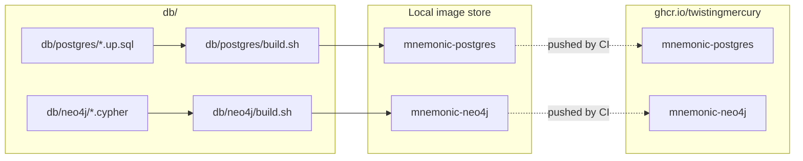

# Database Images — Deployment Architecture

> Back to [Database Architecture](README.md) | [Design Index](../../README.md)

## Table of Contents

- [Deployment Overview](#deployment-overview)
- [Image Build Pipeline](#image-build-pipeline)
- [CI/CD](#cicd)
- [Image Tagging Strategy](#image-tagging-strategy)
- [Updates and Rollbacks](#updates-and-rollbacks)

## Deployment Overview

The `db/` component does not deploy running services. Its output is two Docker images. Application services pull these images and run them as database containers. The images are published to GitHub Container Registry (GHCR) by CI once the workflows exist (see [CI/CD](#cicd)); no workflow is written yet.



## Image Build Pipeline

### mnemonic-postgres

Built with a standard `docker build` (`db/postgres/build.sh`). The `Dockerfile` is in `db/postgres/`:

1. `FROM pgvector/pgvector:pg16`
2. Sets the `POSTGRES_DB` and `POSTGRES_USER` environment variables; the caller supplies `POSTGRES_PASSWORD`
3. Copies all `*.up.sql` files into `/docker-entrypoint-initdb.d/`

On first container start with an empty data directory, Postgres runs the init scripts in filename order, applying all 10 migrations (`000001` to `000010`) automatically. No external tooling required.

### mnemonic-neo4j

Built with a standard `docker build` (`db/neo4j/build.sh`), then tagged. The schema is not applied at build time: the `neo4j` base image declares `/data` as a Docker `VOLUME`, and `docker commit` drops volume contents, so seeding a temporary container and committing it does not work. Instead the image applies its schema every time a container starts. The `Dockerfile` in `db/neo4j/`:

1. `FROM neo4j:5`, with `NEO4J_AUTH` and the APOC plugin settings
2. Copies the three Cypher files into `/startup/schema/` and `schema-entrypoint.sh` into `/startup/`
3. Replaces the entrypoint with `schema-entrypoint.sh` (under `tini`), which runs the base entrypoint in the foreground
4. Sets a `HEALTHCHECK` that passes only once `/tmp/schema_ready` exists

At container start, `schema-entrypoint.sh` removes any stale `/tmp/schema_ready`, forks a background job and then `exec`s the base entrypoint, so Neo4j stays the foreground process and receives `SIGTERM` directly. The background job:

1. Polls `cypher-shell` until Neo4j accepts connections (by default 60 attempts, 2 seconds apart)
2. Applies the Cypher files in sorted order, skipping `002_create_existence_constraints.cypher` unless the edition is Enterprise
3. Writes `/tmp/schema_ready`

Every Cypher file is idempotent, so restarting a container against an existing volume is safe. If a file fails to apply, the job stops Neo4j so the container does not look healthy without its schema.

## CI/CD

The CI workflow (`.github/workflows/ci.yaml`) builds, tests and publishes the database images; see [Continuous integration](../../../../README.md#continuous-integration). The local pieces are:

- `db/postgres/build.sh` and `db/neo4j/build.sh` build and tag the images locally. They never push. Set `MNEMONIC_VERSION` to override the version (for example `MNEMONIC_VERSION=v1.0.0 bash db/postgres/build.sh`); without it the scripts use `build/version.sh db`.
- `db/tests/postgres-test-runner.sh`, `db/tests/neo4j-test-runner.sh` and the BATS suites under `db/tests/bats/` test the schema; see the [db README](../../../../db/README.md) for how to run them.

For every component the build script builds the image and runs its tests, and the CI `publish` job then logs in to GHCR and pushes the tested image. The triggers, jobs and tag rules are settled in [ci_workflows.md](../../ci_workflows.md): a push to develop publishes `latest-dev` and `sha-<short>`; publishing runs on a push to develop or main, not on a tag.

## Image Tagging Strategy

Both build scripts tag the image with a version and with `latest`. The version is `MNEMONIC_VERSION` when set, otherwise `v` plus the result of `build/version.sh db` (from the `db/vX.Y.Z` tags; `0.0.0-dev` when there is none).

The `-dev` suffix scheme (`:latest-dev`, `:v1.0.0-dev`) is what the consumers reference today. The CI `publish` job pushes only `latest-dev` and `sha-<short>` from `develop`; it does not push a `-dev` version tag.

Application services pin a specific tag rather than a floating one: the compose files (`deploy/docker-compose.yaml`, `tests/integration/docker-compose.yaml`) and the Helm chart (`deploy/helm/mnemonic/values.yaml`) all use `:v1.0.0-dev`. Picking up a schema change therefore means bumping that tag in those files (step 5 below).

## Updates and Rollbacks

**Schema update process:**

1. Add or modify SQL/Cypher files in `db/postgres/` or `db/neo4j/`
2. Update BATS tests to cover the new schema state
3. Run the test runners in `db/tests/` and build the images with the build scripts
4. Tag the component release (`db/vX.Y.Z`); publishing is done by CI on a push to develop or main, not by the tag (see [ci_workflows.md](../../ci_workflows.md))
5. Update image references in `deploy/docker-compose.yaml`, `tests/integration/docker-compose.yaml` and `deploy/helm/mnemonic/values.yaml`

**Rollback:**
Pull a prior image tag. Because the schema ships inside the image, rolling back means pointing the application at an older tag. No down migration scripts are maintained.

```bash
# Roll back to a prior tag (for example v1.0.0-dev, the tag consumers pin today)
docker pull ghcr.io/twistingmercury/mnemonic-postgres:<prior-tag>
docker pull ghcr.io/twistingmercury/mnemonic-neo4j:<prior-tag>
```

**Next:** [Data Architecture](08-data-architecture.md)

---

Copyright (c) 2025-2026 Jeremy K. Johnson. Licensed under FSL-1.1-ALv2; see [LICENSE](../../../../LICENSE).
