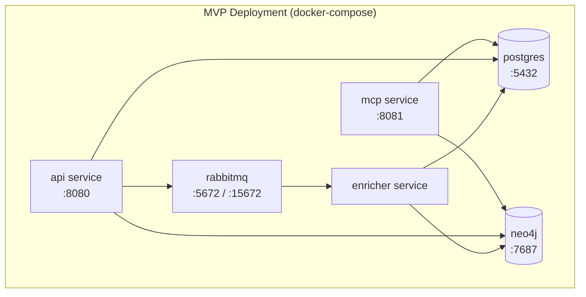
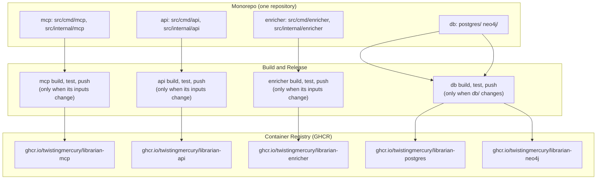

# Deployment Architecture

> Back to [System Architecture](README.md) | [Design Index](../../README.md)

## Table of Contents

- [MVP](#mvp)
  - [Deployment Overview](#deployment-overview)
  - [Deployment Topology](#deployment-topology)
  - [Component Deployment](#component-deployment)
  - [Infrastructure Requirements](#infrastructure-requirements)
  - [Operational Considerations](#operational-considerations)
  - [Independent Deployment Pipelines](#independent-deployment-pipelines)
- [Post-MVP](#post-mvp)
  - [MVP 3: Managed Infrastructure](#mvp-3-managed-infrastructure)
  - [MVP 4: Kubernetes Deployment](#mvp-4-kubernetes-deployment)
  - [MVP 5: Cloud-Native Production](#mvp-5-cloud-native-production)

## MVP

### Deployment Overview

Mnemonic deploys as six containers orchestrated by docker-compose. Three application services handle distinct responsibilities: read-only MCP serving, admin CRUD, and asynchronous enrichment. RabbitMQ decouples write-path operations from enrichment processing. The services call the OpenAI API for embeddings and concept extraction; Claude Code's own inference and tool execution happen on user workstations.

The full six-container local stack is defined in `deploy/docker-compose.yaml`. Compose files in the monorepo:

| File                                                              | Contents                                                                                                                                                   |
| ----------------------------------------------------------------- | ---------------------------------------------------------------------------------------------------------------------------------------------------------- |
| `deploy/docker-compose.yaml`                                      | Local stack: Envoy edges, OPA, Keycloak, the OpenAI egress proxy, postgres, neo4j, rabbitmq, and the api, mcp and enricher services (see the gateway docs) |
| `tests/legacy/<service>/docker-compose.yaml` (api, mcp, enricher) | Former per-service E2E suites, kept under `tests/legacy/`, with an OpenAI stub in place of api.openai.com                                                  |
| `tests/integration/docker-compose.yaml`                           | Cross-service black-box tests: all three published `latest-dev` images, postgres, neo4j, rabbitmq and an OpenAI stub (`LIBRARIAN_OPENAI_BASE_URL`)         |

The enricher service has no compose file of its own; it runs from `deploy/docker-compose.yaml`.

```mermaid
graph TB
    subgraph "User Workstations"
        WS1[Workstation 1<br/>Claude Code]
        WS2[Workstation 2<br/>Claude Code]
        WS3[Workstation N<br/>Claude Code]
    end

    subgraph "Admin Tools"
        ADMIN[Admin UI (not in this repo for now) / curl]
    end

    subgraph "Server Infrastructure (docker-compose)"
        MCP[mcp service<br/>MCP Server :8081<br/>health :8080, metrics :9090]
        API[api service<br/>Admin REST API :8080<br/>metrics :9090]
        ENRICHER[enricher service<br/>Enrichment Worker<br/>health :8080, metrics :9090]
        RMQ[rabbitmq<br/>:5672 / :15672]
        PG[(postgres<br/>PostgreSQL + PGVector<br/>:5432)]
        NEO[(neo4j<br/>Neo4j<br/>:7687)]
    end

    OAI([OpenAI API])

    WS1 -->|"MCP /mcp"| MCP
    WS2 -->|"MCP /mcp"| MCP
    WS3 -->|"MCP /mcp"| MCP
    ADMIN -->|"REST /v1/api"| API
    MCP --> PG
    MCP --> NEO
    API --> PG
    API --> NEO
    API -->|"publish enrichment-jobs"| RMQ
    RMQ -->|"consume"| ENRICHER
    ENRICHER --> PG
    ENRICHER --> NEO
    MCP & API & ENRICHER --> OAI
```

| Container        | Image                                                                                                  | Container ports                                                        | Role                   |
| ---------------- | ------------------------------------------------------------------------------------------------------ | ---------------------------------------------------------------------- | ---------------------- |
| mcp service      | ghcr.io/twistingmercury/librarian-mcp                                                                  | 8081 (`/mcp`), 8080 (`/health`, `/version`), 9090 (`/metrics`)         | MCP server (read-only) |
| api service      | ghcr.io/twistingmercury/librarian-api                                                                  | 8080 (`/v1/api`, `/swagger`, `/health`, `/version`), 9090 (`/metrics`) | Admin REST API         |
| enricher service | ghcr.io/twistingmercury/librarian-enricher                                                             | 8080 (`/health`, `/version`), 9090 (`/metrics`)                        | Enrichment worker      |
| rabbitmq         | rabbitmq:3-management-alpine (api and integration-tests compose; mcp compose uses 4-management-alpine) | 5672/15672                                                             | Message queue          |
| postgres         | ghcr.io/twistingmercury/librarian-postgres:v1.0.0-dev                                                  | 5432                                                                   | PostgreSQL + PGVector  |
| neo4j            | ghcr.io/twistingmercury/librarian-neo4j:v1.0.0-dev                                                     | 7687                                                                   | Neo4j                  |

The application images are built `FROM scratch` and tagged from `develop`: `latest-dev` and `vX.Y.Z-dev`. The version comes from the component's own tag (for example `api/v0.4.0` gives `v0.4.0-dev`). Health checks run the binary with `--health`, which calls its own `/health`: the api image declares this as a Docker `HEALTHCHECK`, and the compose files declare it for all three services. Host port mappings differ per compose file (see the table above).

### Deployment Topology

#### Logical View

```mermaid
graph TB
    subgraph "Client Tier"
        CC[Claude Code via MCP]
        ADMIN[Admin UI (not in this repo for now) / curl]
    end

    subgraph "Application Tier"
        MCP[mcp service<br/>Read-Only MCP Server]
        API[api service<br/>Admin REST API]
        ENRICHER[enricher service<br/>Enrichment Worker]
    end

    subgraph "Messaging Tier"
        RMQ[RabbitMQ]
    end

    subgraph "Data Tier"
        PG[(Postgres + PGVector)]
        NEO[(Neo4j)]
    end

    CC -->|"MCP"| MCP
    ADMIN -->|"REST"| API
    MCP --> PG
    MCP --> NEO
    API --> PG
    API --> NEO
    API -->|"publish"| RMQ
    RMQ -->|"consume"| ENRICHER
    ENRICHER --> PG
    ENRICHER --> NEO
```

#### Physical View

All six containers run on a single host via docker-compose.

```mermaid
graph TB
    subgraph "Developer Machines"
        D1[Dev 1<br/>Claude Code MCP]
        D2[Dev 2<br/>Claude Code MCP]
        DN[Dev N<br/>Claude Code MCP]
        ADMIN[Admin UI (not in this repo for now) / curl]
    end

    subgraph "Server Environment (docker-compose)"
        MCP[mcp service<br/>:8081]
        API[api service<br/>:8080]
        ENRICHER[enricher service]
        RMQ[rabbitmq<br/>:5672 / :15672]
        PG[(postgres<br/>:5432)]
        NEO[(neo4j<br/>:7687)]
    end

    D1 -->|"MCP"| MCP
    D2 -->|"MCP"| MCP
    DN -->|"MCP"| MCP
    ADMIN -->|"REST"| API
    MCP --> PG
    MCP --> NEO
    API --> PG
    API --> NEO
    API -->|"publish"| RMQ
    RMQ -->|"consume"| ENRICHER
    ENRICHER --> PG
    ENRICHER --> NEO
```

### Component Deployment

#### Mnemonic MCP Server

**Deployment Location:** Server infrastructure (docker-compose)

**Characteristics:**

- Read-only MCP interface for Claude Code pattern searches
- Connects to Postgres (PGVector semantic search), Neo4j (graph traversal) and the OpenAI embeddings API (query vectors)
- Stateless; horizontally scalable
- No write operations; safe to run multiple instances behind a load balancer

**Resource Requirements:**

| Resource | Expectation                                    |
| -------- | ---------------------------------------------- |
| CPU      | Low (pattern queries, MCP serving)             |
| Memory   | Moderate (connection pools, response assembly) |
| Storage  | None (reads from external databases)           |
| Network  | Moderate (all MCP client traffic)              |

#### Mnemonic Admin API

**Deployment Location:** Server infrastructure (docker-compose)

**Characteristics:**

- REST API for pattern CRUD and search
- Connects to Postgres for persistent storage, RabbitMQ for enrichment dispatch, and the OpenAI embeddings API for search queries
- Reads Neo4j for pattern graph context; deletes a pattern's graph node best-effort on `DELETE` (the enricher builds the graph)
- Startup fails if RabbitMQ is unreachable at that moment; later broker outages only degrade `/health` to Warning
- Stateless; horizontally scalable

**Resource Requirements:**

| Resource | Expectation                               |
| -------- | ----------------------------------------- |
| CPU      | Low (CRUD operations, message publishing) |
| Memory   | Low to moderate (connection pools)        |
| Storage  | None (writes to external databases)       |
| Network  | Low (admin traffic only)                  |

#### Mnemonic Enricher

**Deployment Location:** Server infrastructure (docker-compose)

**Characteristics:**

- Consumes enrichment messages from the RabbitMQ `enrichment-jobs` queue, and every 15 seconds claims due retries and undelivered jobs from Postgres
- Connects to Postgres (read/write embeddings and job state), Neo4j (write graph relationships), and the OpenAI API (embeddings and concept extraction)
- Horizontally scalable; multiple workers can consume from the same queue (`SKIP LOCKED` claims, conditional job start)
- Inbound HTTP only for `/health` and `/version` (:8080) and `/metrics` (:9090)

**Resource Requirements:**

| Resource | Expectation                                        |
| -------- | -------------------------------------------------- |
| CPU      | Low to moderate (embedding requests are I/O-bound) |
| Memory   | Low to moderate (message processing)               |
| Storage  | None (writes to external databases)                |
| Network  | Moderate (OpenAI API calls, database writes)       |

#### RabbitMQ

**Deployment Location:** Server infrastructure (docker-compose)

**Characteristics:**

- Message queue for async enrichment dispatch between Admin API and Enricher
- Management UI available on port 15672
- Uses the stock `rabbitmq` management image (no custom build); the api compose file uses `rabbitmq:3-management-alpine`
- The API declares the `enrichment-jobs` queue as durable and publishes persistent messages

**Resource Requirements:**

| Resource | Expectation                                                                                                                                                                                                          |
| -------- | -------------------------------------------------------------------------------------------------------------------------------------------------------------------------------------------------------------------- |
| CPU      | Low (message routing)                                                                                                                                                                                                |
| Memory   | Low (small queue depth expected)                                                                                                                                                                                     |
| Storage  | Low; the compose files mount no RabbitMQ volume except the mcp one, so queued messages can be lost when the container is recreated. PostgreSQL job rows remain the source of truth and the retry sweep recovers them |
| Network  | Low (internal container traffic only)                                                                                                                                                                                |

### Infrastructure Requirements

#### Server Infrastructure

The server-side deployment consists of six containers running via docker-compose, suitable for small teams.



#### Client Requirements

| Requirement       | MVP Local Deployment        |
| ----------------- | --------------------------- |
| Claude Code       | Required                    |
| MCP Support       | Required                    |
| Anthropic API key | Via Claude Code             |
| Network access    | To the mcp service on :8081 |

#### Admin Requirements

| Requirement    | MVP Local Deployment                                                           |
| -------------- | ------------------------------------------------------------------------------ |
| HTTP client    | Required (curl, or the admin UI, which is not part of this repository for now) |
| Network access | To the api service on :8080                                                    |
| Authentication | None (trusted network)                                                         |

### Operational Considerations

#### Monitoring

Key metrics to monitor:

| Component        | Metrics                                                                                                                                                |
| ---------------- | ------------------------------------------------------------------------------------------------------------------------------------------------------ |
| mcp service      | `http.server.request.duration` (otelgin), `mnemonic.mcp.tool_calls`, `mnemonic.mcp.tool_duration`, `mnemonic.patterns.query_latency` / `returned`      |
| api service      | `http.server.request.duration` (otelgin), `mnemonic.db.query_latency` / `query_errors`, `mnemonic.patterns.*`, `mnemonic.queue.publish_failures_total` |
| enricher service | `mnemonic.enrichment.jobs`, `mnemonic.enrichment.job_duration`, pending job age in `enrichment_jobs`                                                   |
| RabbitMQ         | Queue depth, message rates, consumer count                                                                                                             |
| Postgres         | Connection count, query latency, storage usage                                                                                                         |
| Neo4j            | Query latency, memory usage, connection count                                                                                                          |

#### Logging

All application services emit structured logs with trace correlation via OpenTelemetry (see [Observability Architecture](07-observability-architecture.md)).

| Component        | Log Focus                                       |
| ---------------- | ----------------------------------------------- |
| mcp service      | Pattern searches, errors                        |
| api service      | CRUD operations, message publishing, errors     |
| enricher service | Enrichment processing, OpenAI API calls, errors |

### Independent Deployment Pipelines

Each application service and the database images build and release independently. Database migrations and application code are versioned and deployed independently.



Each component has its own build script (`build/<component>/<component>.build.sh` for the Go services, `db/postgres/build.sh` and `db/neo4j/build.sh` for the database images). Release tags are per component (`api/vX.Y.Z`, `mcp/vX.Y.Z`, `enricher/vX.Y.Z`, `db/vX.Y.Z`, `helm/vX.Y.Z`), so tagging one component does not build or publish another. CI workflows for the monorepo are not in the repository yet; the intended model is that a push to `develop` builds only the components whose inputs changed, and that pull request builds run the same build and tests without pushing. Dependabot configuration is also still to come.

**Pipeline Summary:**

| Pipeline          | Location                                    | Triggers On                                                                     | Produces                                     |
| ----------------- | ------------------------------------------- | ------------------------------------------------------------------------------- | -------------------------------------------- |
| mcp build         | `src/cmd/mcp`, `src/internal/mcp`           | changes to its Go dependencies, `build/mcp/`, `src/go.mod` or `src/go.sum`      | `ghcr.io/twistingmercury/librarian-mcp`      |
| api build         | `src/cmd/api`, `src/internal/api`           | changes to its Go dependencies, `build/api/`, `src/go.mod` or `src/go.sum`      | `ghcr.io/twistingmercury/librarian-api`      |
| enricher build    | `src/cmd/enricher`, `src/internal/enricher` | changes to its Go dependencies, `build/enricher/`, `src/go.mod` or `src/go.sum` | `ghcr.io/twistingmercury/librarian-enricher` |
| Integration Tests | `tests/integration`                         | push/PR to `develop`, nightly                                                   | Pass/fail only (no image)                    |
| db build          | `db/`                                       | changes under `db/postgres/` or `db/neo4j/`                                     | Database images                              |

**Why Independent Pipelines?**

| Scenario           | Without Separation              | With Separation                   |
| ------------------ | ------------------------------- | --------------------------------- |
| MCP query bug fix  | Rebuilds all services           | Only the mcp service deploys      |
| New admin endpoint | Rebuilds MCP and enricher too   | Only the api service deploys      |
| Schema migration   | Rebuilds all application images | Only database images rebuild      |
| Enricher tuning    | Touches unrelated services      | Only the enricher service deploys |

**Deployment Order for Breaking Changes:**

```text
1. Deploy database images (forward-compatible: nullable/default values)
2. Verify schema changes succeeded
3. Deploy application services (use new schema)
4. (Optional) Deploy tightening migration (add NOT NULL, remove old columns)
```

This separation ensures:

- Faster deployments (only deploy what changed)
- Safer rollbacks (can rollback one service without touching others)
- Clear audit trail (which pipeline changed what)

## Post-MVP

### MVP 3: Managed Infrastructure

Move stateful infrastructure to AWS managed services while keeping application services running locally:

- Replace local PostgreSQL + PGVector with AWS RDS PostgreSQL + PGVector
- Replace local Neo4j with AWS Neptune
- Replace local RabbitMQ with AWS SQS

Application services (mcp, api and enricher services) remain local. This validates cloud data-tier connectivity without changing the application runtime.

See [MVP 3 concept diagram](../../diagrams/03-concept-local-iteration.md).

### MVP 4: Kubernetes Deployment

Deploy application services to local Kubernetes (minikube or equivalent single-node cluster):

- Add Envoy proxy as the ingress and authN layer for MCP and Admin API traffic
- Add OPA policies as the authZ checkpoint before requests reach service handlers
- Begin Helm chart development for repeatable local cluster deployment
- Keep data and queue infrastructure on managed AWS services (from MVP 3)

See [MVP 4 concept diagram](../../diagrams/04-concept-local-iteration.md).

### MVP 5: Cloud-Native Production

Deploy the full stack to AWS:

- Move application services from local Kubernetes to AWS Fargate
- Envoy + OPA remain in the request path for authN/authZ
- Provision all AWS infrastructure (networking, compute, managed services) with Terraform
- Use SSM Parameter Store and Secrets Manager for runtime configuration and secrets

See [MVP 5 concept diagram](../../diagrams/05-concept-cloud-iteration.md).

**Next:** [Observability Architecture](07-observability-architecture.md)

---

Copyright (c) 2025-2026 Jeremy K. Johnson. All rights reserved.
