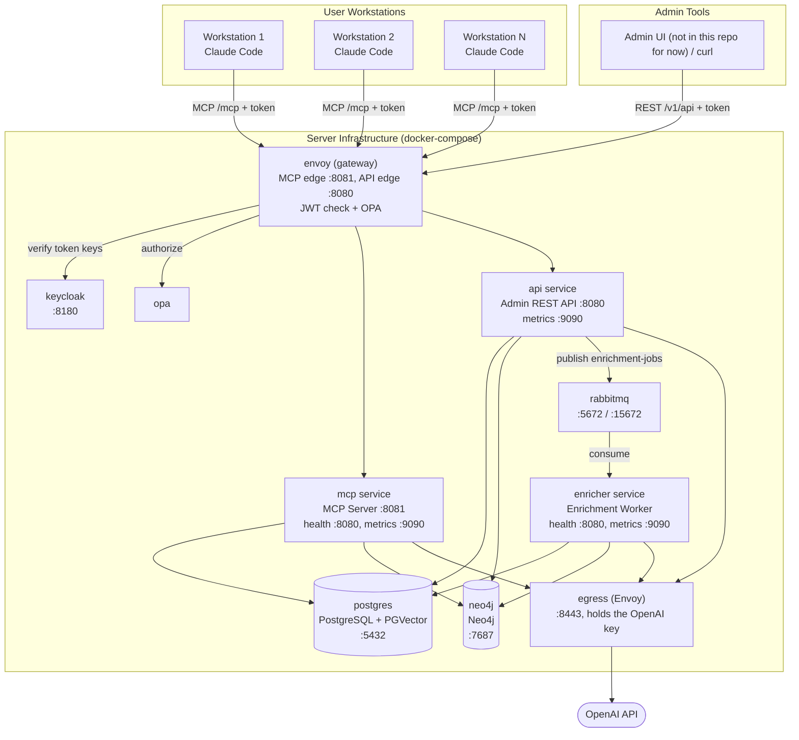
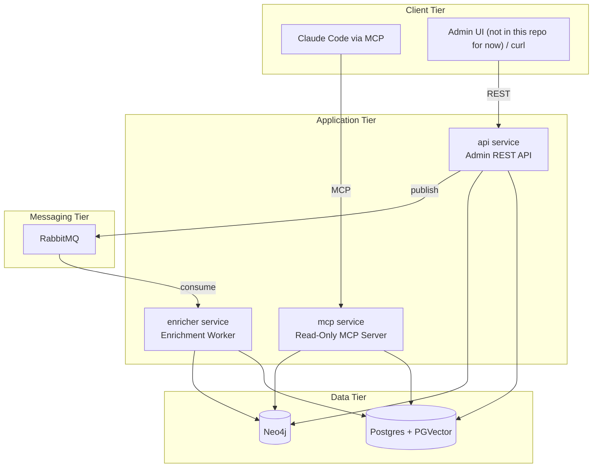
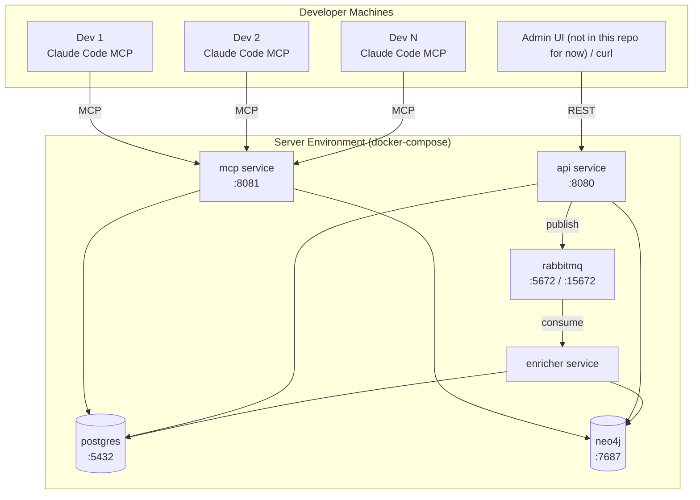
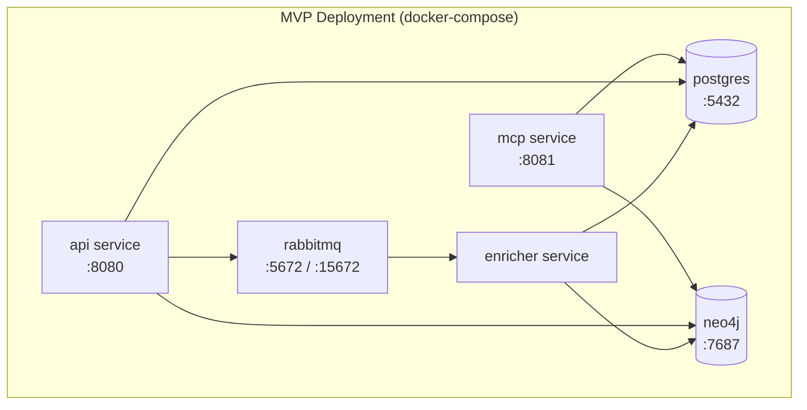
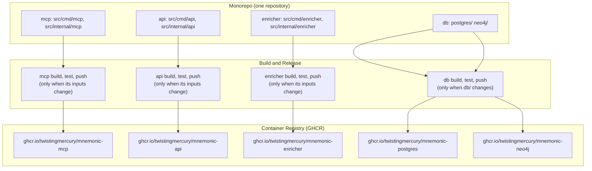

# Deployment Architecture

> Back to [System Architecture](README.md) | [Design Index](../../README.md)

## Table of Contents

- [MVP](#mvp)
  - [Deployment Overview](#deployment-overview)
  - [Deployment Topology](#deployment-topology)
  - [Component Deployment](#component-deployment)
  - [Infrastructure Requirements](#infrastructure-requirements)
  - [Operational Considerations](#operational-considerations)
  - [Independent Deployment Pipelines](#independent-deployment-pipelines)
- [Post-MVP](#post-mvp)
  - [MVP 3: Managed Infrastructure](#mvp-3-managed-infrastructure)
  - [MVP 4: Kubernetes Deployment](#mvp-4-kubernetes-deployment)
  - [MVP 5: Cloud-Native Production](#mvp-5-cloud-native-production)

## MVP

### Deployment Overview

Mnemonic's local stack runs as ten containers orchestrated by docker-compose. Three application services handle distinct responsibilities: read-only MCP serving, admin CRUD, and asynchronous enrichment. RabbitMQ decouples write-path operations from enrichment processing. Postgres and Neo4j hold the data. In front of the services, the gateway (Envoy, OPA, Keycloak) authenticates and authorizes every request; behind them, an Envoy egress proxy is the only container that reaches the OpenAI API and the only one that holds the API key. The services call OpenAI through that proxy for embeddings and concept extraction; Claude Code's own inference and tool execution happen on user workstations. See the [gateway README](../../../../gateway/README.md) for the gateway and egress details.

The local stack is defined in `deploy/docker-compose.yaml`; the Helm chart `deploy/helm/mnemonic` deploys the same stack to a local minikube cluster. Compose files in the monorepo:

| File                                    | Contents                                                                                                                                                                                           |
| --------------------------------------- | -------------------------------------------------------------------------------------------------------------------------------------------------------------------------------------------------- |
| `deploy/docker-compose.yaml`            | Local stack: Envoy edges, OPA, Keycloak, the OpenAI egress proxy, postgres, neo4j, rabbitmq, and the api, mcp and enricher services (see the gateway docs)                                         |
| `tests/integration/docker-compose.yaml` | End-to-end suite: the three services (the one just built, plus the others' `latest-dev` images), postgres, neo4j, rabbitmq, an OpenAI stub (`MNEMONIC_OPENAI_BASE_URL`) and the Python test runner |

No service has a compose file of its own; all three run from these two files.



| Container        | Image                                                                                      | Container ports                                                        | Role                                  |
| ---------------- | ------------------------------------------------------------------------------------------ | ---------------------------------------------------------------------- | ------------------------------------- |
| envoy            | envoyproxy/envoy:v1.34.1                                                                   | 8080 (api edge), 8081 (mcp edge)                                       | Gateway: JWT check, OPA authorization |
| opa              | openpolicyagent/opa:1.4.2-envoy-static                                                     | 9191 (ext_authz gRPC), 8181                                            | Authorization policy                  |
| keycloak         | keycloak/keycloak:26.2.5                                                                   | 8080 (published on host 8180)                                          | Token issuer                          |
| egress           | envoyproxy/envoy:v1.34.1                                                                   | 8443                                                                   | OpenAI egress proxy, holds the key    |
| mcp service      | ghcr.io/twistingmercury/mnemonic-mcp                                                       | 8081 (`/mcp`), 8080 (`/health`, `/version`), 9090 (`/metrics`)         | MCP server (read-only)                |
| api service      | ghcr.io/twistingmercury/mnemonic-api                                                       | 8080 (`/v1/api`, `/swagger`, `/health`, `/version`), 9090 (`/metrics`) | Admin REST API                        |
| enricher service | ghcr.io/twistingmercury/mnemonic-enricher                                                  | 8080 (`/health`, `/version`), 9090 (`/metrics`)                        | Enrichment worker                     |
| rabbitmq         | rabbitmq:4-management-alpine (`deploy/`; the integration compose uses 3-management-alpine) | 5672/15672                                                             | Message queue                         |
| postgres         | ghcr.io/twistingmercury/mnemonic-postgres:v1.0.0-dev                                       | 5432                                                                   | PostgreSQL + PGVector                 |
| neo4j            | ghcr.io/twistingmercury/mnemonic-neo4j:v1.0.0-dev                                          | 7687                                                                   | Neo4j                                 |

The application images are built `FROM scratch`. The service build scripts tag each image `vX.Y.Z` and `latest`, taking the version from the component's own tag through `build/version.sh` (for example `api/v0.5.0` gives `v0.5.0`; `0.0.0-dev` when the component has no tag yet). The database build scripts (`db/postgres/build.sh`, `db/neo4j/build.sh`) do not use the `db/` tag yet: they tag `MNEMONIC_VERSION`, or else the newest tag of any component from `git describe` (`dev` when there is none), plus `latest`. The compose files and the Helm chart reference `latest-dev` for the services and `v1.0.0-dev` for the database images; those `-dev` tags are meant to be applied when CI pushes from `develop`, and no CI workflow exists yet to do that. Health checks run the binary with `--health`, which calls its own `/health`: the api image declares this as a Docker `HEALTHCHECK`, and `tests/integration/docker-compose.yaml` declares it for all three services. `deploy/docker-compose.yaml` declares no health check for the services, and the Helm chart probes `/health` over HTTP. The table lists container ports. In `deploy/docker-compose.yaml` only the gateway publishes host ports: 8080 (api edge), 8081 (mcp edge) and 8180 (Keycloak); the services, RabbitMQ (including its management UI) and the data stores are reachable only on the internal network.

### Deployment Topology

#### Logical View



#### Physical View

All containers of the local stack run on a single host via docker-compose. The logical view, this view and the Server Infrastructure diagram leave out the gateway and egress containers shown in [Deployment Overview](#deployment-overview); every client request passes through the Envoy edge, and every OpenAI call through the egress proxy.



### Component Deployment

#### Mnemonic MCP Server

**Deployment Location:** Server infrastructure (docker-compose)

**Characteristics:**

- Read-only MCP interface for Claude Code pattern searches
- Connects to Postgres (PGVector semantic search), Neo4j (graph traversal) and, through the egress proxy, the OpenAI embeddings API (query vectors)
- Stateless; horizontally scalable
- No write operations; safe to run multiple instances behind a load balancer

**Resource Requirements:**

| Resource | Expectation                                    |
| -------- | ---------------------------------------------- |
| CPU      | Low (pattern queries, MCP serving)             |
| Memory   | Moderate (connection pools, response assembly) |
| Storage  | None (reads from external databases)           |
| Network  | Moderate (all MCP client traffic)              |

#### Mnemonic Admin API

**Deployment Location:** Server infrastructure (docker-compose)

**Characteristics:**

- REST API for pattern CRUD and search
- Connects to Postgres for persistent storage, RabbitMQ for enrichment dispatch, and, through the egress proxy, the OpenAI embeddings API for search queries
- Reads Neo4j for pattern graph context; deletes a pattern's graph node best-effort on `DELETE` (the enricher builds the graph)
- Startup fails if RabbitMQ is unreachable at that moment; later broker outages only degrade `/health` to Warning
- Stateless; horizontally scalable

**Resource Requirements:**

| Resource | Expectation                               |
| -------- | ----------------------------------------- |
| CPU      | Low (CRUD operations, message publishing) |
| Memory   | Low to moderate (connection pools)        |
| Storage  | None (writes to external databases)       |
| Network  | Low (admin traffic only)                  |

#### Mnemonic Enricher

**Deployment Location:** Server infrastructure (docker-compose)

**Characteristics:**

- Consumes enrichment messages from the RabbitMQ `enrichment-jobs` queue, and every 15 seconds claims due retries and undelivered jobs from Postgres
- Connects to Postgres (read/write embeddings and job state), Neo4j (write graph relationships), and, through the egress proxy, the OpenAI API (embeddings and concept extraction)
- Horizontally scalable; multiple workers can consume from the same queue (`SKIP LOCKED` claims, conditional job start)
- Inbound HTTP only for `/health` and `/version` (:8080) and `/metrics` (:9090)

**Resource Requirements:**

| Resource | Expectation                                        |
| -------- | -------------------------------------------------- |
| CPU      | Low to moderate (embedding requests are I/O-bound) |
| Memory   | Low to moderate (message processing)               |
| Storage  | None (writes to external databases)                |
| Network  | Moderate (OpenAI API calls, database writes)       |

#### RabbitMQ

**Deployment Location:** Server infrastructure (docker-compose)

**Characteristics:**

- Message queue for async enrichment dispatch between Admin API and Enricher
- Management UI on container port 15672 (not published to the host by `deploy/docker-compose.yaml`)
- Uses the stock `rabbitmq` management image (no custom build); `deploy/docker-compose.yaml` uses `rabbitmq:4-management-alpine`
- The API declares the `enrichment-jobs` queue as durable and publishes persistent messages

**Resource Requirements:**

| Resource | Expectation                                                                                                                                                                                                                                                    |
| -------- | -------------------------------------------------------------------------------------------------------------------------------------------------------------------------------------------------------------------------------------------------------------- |
| CPU      | Low (message routing)                                                                                                                                                                                                                                          |
| Memory   | Low (small queue depth expected)                                                                                                                                                                                                                               |
| Storage  | Low; neither compose file mounts a RabbitMQ volume, so queued messages can be lost when the container is recreated (the Helm chart gives RabbitMQ a persistent volume claim). PostgreSQL job rows remain the source of truth and the retry sweep recovers them |
| Network  | Low (internal container traffic only)                                                                                                                                                                                                                          |

### Infrastructure Requirements

#### Server Infrastructure

The server-side deployment runs on one host via docker-compose, suitable for small teams. The diagram shows the six application and data containers; the gateway and egress containers sit in front of and behind them as shown in [Deployment Overview](#deployment-overview).



#### Client Requirements

| Requirement       | MVP Local Deployment                                 |
| ----------------- | ---------------------------------------------------- |
| Claude Code       | Required                                             |
| MCP Support       | Required                                             |
| Anthropic API key | Via Claude Code                                      |
| Network access    | To the Envoy MCP edge on host port 8081              |
| Authentication    | Bearer token from Keycloak (audience `mnemonic-mcp`) |

#### Admin Requirements

| Requirement    | MVP Local Deployment                                                                    |
| -------------- | --------------------------------------------------------------------------------------- |
| HTTP client    | Required (curl, or the admin UI, which is not part of this repository for now)          |
| Network access | To the Envoy API edge on host port 8080                                                 |
| Authentication | Bearer token from Keycloak (audience `mnemonic-api`), verified by Envoy, checked by OPA |

### Operational Considerations

#### Monitoring

Key metrics to monitor:

| Component        | Metrics                                                                                                                                                |
| ---------------- | ------------------------------------------------------------------------------------------------------------------------------------------------------ |
| mcp service      | `http.server.request.duration` (otelgin), `mnemonic.mcp.tool_calls`, `mnemonic.mcp.tool_duration`, `mnemonic.patterns.query_latency` / `returned`      |
| api service      | `http.server.request.duration` (otelgin), `mnemonic.db.query_latency` / `query_errors`, `mnemonic.patterns.*`, `mnemonic.queue.publish_failures_total` |
| enricher service | `mnemonic.enrichment.jobs`, `mnemonic.enrichment.job_duration`, pending job age in `enrichment_jobs`                                                   |
| RabbitMQ         | Queue depth, message rates, consumer count                                                                                                             |
| Postgres         | Connection count, query latency, storage usage                                                                                                         |
| Neo4j            | Query latency, memory usage, connection count                                                                                                          |

#### Logging

All application services emit structured logs with trace correlation via OpenTelemetry (see [Observability Architecture](07-observability-architecture.md)).

| Component        | Log Focus                                       |
| ---------------- | ----------------------------------------------- |
| mcp service      | Pattern searches, errors                        |
| api service      | CRUD operations, message publishing, errors     |
| enricher service | Enrichment processing, OpenAI API calls, errors |

### Independent Deployment Pipelines

Each application service and the database images build and release independently. Database migrations and application code are versioned and deployed independently.



Each component has its own build script (`build/<component>/<component>.build.sh` for the Go services, `db/postgres/build.sh` and `db/neo4j/build.sh` for the database images). Release tags are per component (`api/vX.Y.Z`, `mcp/vX.Y.Z`, `enricher/vX.Y.Z`, `db/vX.Y.Z`, later `helm/vX.Y.Z`), so tagging one component does not build or publish another. The service build scripts read these tags; the database build scripts do not yet (see [Deployment Overview](#deployment-overview)).

Tests run inside the builds. Each service's Dockerfile runs the quality gates and the Go unit tests (`CGO_ENABLED=1 go test -race`) while building the image; the service build script then runs the whole Python end-to-end suite (`tests/integration`) in containers against the image just built, with the other two services taken from their `latest-dev` images. The build scripts never push and never use the build cache (`--no-cache --pull`). There is no separate Go integration test tier.

CI workflows for the monorepo are not in the repository yet (there is no `.github/` directory); they are designed in [CI Workflows](../../ci_workflows.md). In that design, pushes to `develop` and `main`, pull requests and manual runs build and test only the affected components, and only a push to `develop` or `main` publishes images. Dependabot configuration is also still to come.

**Pipeline Summary** (intended, per the CI design; none of these jobs exists yet):

| Job                       | Runs when                                                                                                                                        | Runs                                                                                                       | Publishes on push to `develop`               |
| ------------------------- | ------------------------------------------------------------------------------------------------------------------------------------------------ | ---------------------------------------------------------------------------------------------------------- | -------------------------------------------- |
| mcp, api, enricher builds | the service's own code or a Go package it imports changed, or `src/go.mod`, `src/go.sum`, `build/`, `tests/integration/` or `tests/openai-stub/` | `build/<service>/<service>.build.sh` (image, unit tests, full e2e suite)                                   | `ghcr.io/twistingmercury/mnemonic-<service>` |
| db                        | `db/` changed                                                                                                                                    | `db/tests/postgres-test-runner.sh`, `db/tests/neo4j-test-runner.sh`, builds                                | `mnemonic-postgres`, `mnemonic-neo4j`        |
| gateway                   | `gateway/` changed                                                                                                                               | OPA policy checks, Envoy config validation, stub-gateway e2e                                               | nothing                                      |
| helm                      | `deploy/helm/` changed                                                                                                                           | `helm lint` and `helm template`                                                                            | nothing                                      |
| static checks             | every run                                                                                                                                        | shellcheck, hadolint, markdownlint, `helm lint --strict`, `bats tests/bats`, `build/check-e2e-boundary.sh` | nothing                                      |

**Why Independent Pipelines?**

| Scenario           | Without Separation              | With Separation                   |
| ------------------ | ------------------------------- | --------------------------------- |
| MCP query bug fix  | Rebuilds all services           | Only the mcp service deploys      |
| New admin endpoint | Rebuilds MCP and enricher too   | Only the api service deploys      |
| Schema migration   | Rebuilds all application images | Only database images rebuild      |
| Enricher tuning    | Touches unrelated services      | Only the enricher service deploys |

**Deployment Order for Breaking Changes:**

```text
1. Deploy database images (forward-compatible: nullable/default values)
2. Verify schema changes succeeded
3. Deploy application services (use new schema)
4. (Optional) Deploy tightening migration (add NOT NULL, remove old columns)
```

This separation ensures:

- Faster deployments (only deploy what changed)
- Safer rollbacks (can rollback one service without touching others)
- Clear audit trail (which pipeline changed what)

## Post-MVP

### MVP 3: Managed Infrastructure

Move stateful infrastructure to AWS managed services while keeping application services running locally:

- Replace local PostgreSQL + PGVector with AWS RDS PostgreSQL + PGVector
- Replace local Neo4j with AWS Neptune
- Replace local RabbitMQ with AWS SQS

Application services (mcp, api and enricher services) remain local. This validates cloud data-tier connectivity without changing the application runtime.

See [MVP 3 concept diagram](../../diagrams/03-concept-local-iteration.md).

### MVP 4: Kubernetes Deployment

Deploy application services to local Kubernetes (minikube or equivalent single-node cluster):

- Add Envoy proxy as the ingress and authN layer for MCP and Admin API traffic
- Add OPA policies as the authZ checkpoint before requests reach service handlers
- Begin Helm chart development for repeatable local cluster deployment
- Keep data and queue infrastructure on managed AWS services (from MVP 3)

Already in the repository, ahead of this plan: the Envoy gateway with JWT verification and OPA authorization, Keycloak as the token issuer, and the Helm chart `deploy/helm/mnemonic`, which deploys the whole stack (data stores and RabbitMQ included, not AWS services) to a local minikube cluster with NetworkPolicy isolation.

See [MVP 4 concept diagram](../../diagrams/04-concept-local-iteration.md).

### MVP 5: Cloud-Native Production

Deploy the full stack to AWS:

- Move application services from local Kubernetes to AWS Fargate
- Envoy + OPA remain in the request path for authN/authZ
- Provision all AWS infrastructure (networking, compute, managed services) with Terraform
- Use SSM Parameter Store and Secrets Manager for runtime configuration and secrets

See [MVP 5 concept diagram](../../diagrams/05-concept-cloud-iteration.md).

**Next:** [Observability Architecture](07-observability-architecture.md)

---

Copyright (c) 2025-2026 Jeremy K. Johnson. Licensed under FSL-1.1-ALv2; see [LICENSE](../../../../LICENSE).
