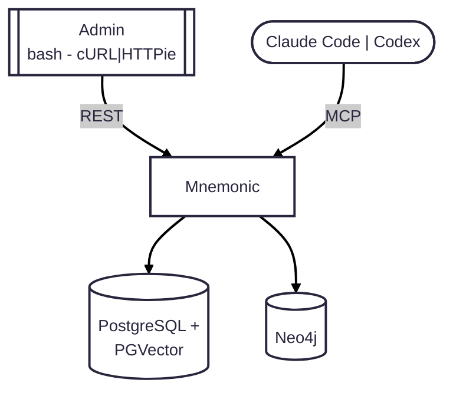

# MVP 1

> Back to [Design Index](../README.md)

Iteration 1 establishes the local baseline:

1. Run a single local Mnemonic service with MCP search and Admin API endpoints.
2. Use local PostgreSQL + PGVector and Neo4j as the initial data stores.
3. Validate end-to-end read/write behavior with manual API and MCP calls.

---

Copyright (c) 2025-2026 Jeremy K. Johnson. Licensed under FSL-1.1-ALv2; see [LICENSE](../../../LICENSE).
