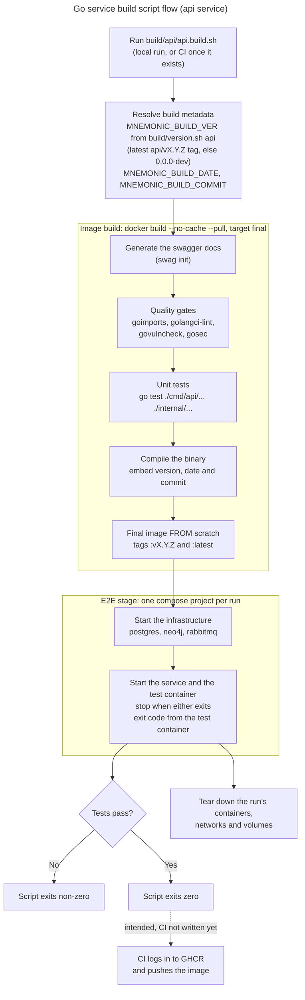

# Build Pipeline Diagram

> Back to [Design Index](../README.md)

This diagram shows how each Go service's build script (`build/<service>/<service>.build.sh`) builds the image and runs the service's end-to-end suite. The steps below are from the api service (`build/api/api.build.sh`, `build/api/api.Dockerfile`, and the shared steps in `build/build-lib.sh`). The mcp and enricher services differ only in image name (`ghcr.io/twistingmercury/mnemonic-mcp` and `ghcr.io/twistingmercury/mnemonic-enricher`), Dockerfile and end-to-end service names.

The build scripts never push. Pushing is the job of CI, but no CI workflow is written yet (the repository has no `.github/workflows/`), so the last steps in the diagram are the intended flow, shown dashed, not something that runs today. The end-to-end suite is still parked under `tests/legacy/` and `make build-api` reports a failing e2e step until those tests are re-homed (see the root `Makefile`).

Whether the script runs locally or in CI, it does the same work: a fresh image build with the quality gates and unit tests inside it, then the end-to-end suite against that image, then cleanup of everything that run created. Details of the CI triggers, tag rules (the `-dev` suffix the compose files reference) and push conditions are not settled and are not documented here until the workflows exist.

---

Copyright (c) 2025-2026 Jeremy K. Johnson. Licensed under FSL-1.1-ALv2; see [LICENSE](../../../LICENSE).
