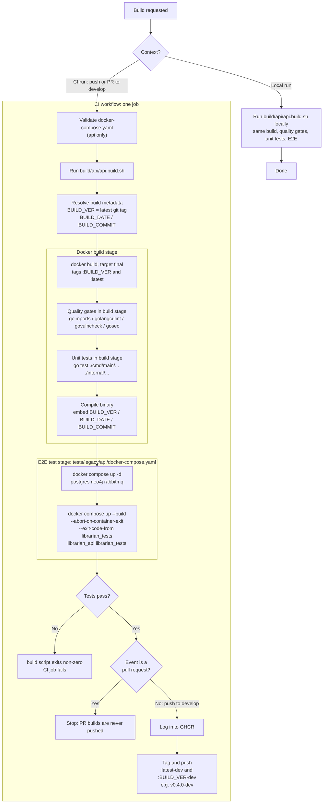

# Build Pipeline Diagram

> Back to [Design Index](../README.md)

This diagram shows how each Go service's build script (`build/<service>/<service>.build.sh`) drives both local builds and CI builds for the api service, the mcp service and the enricher service. The steps below are from the api service (`build/api/api.build.sh`, `build/api/api.Dockerfile`, and the former per-repo workflow `mnemonic-api-ci.yaml`, which is not in the monorepo yet). The other two services differ only in image name (`ghcr.io/twistingmercury/librarian-mcp` for mcp, `ghcr.io/twistingmercury/librarian-enricher` for the enricher), Dockerfile and E2E service names.
<!-- Reference diagram remains in mnemonic/_draft-skills/docker-first-ci-cd-implementation/references/docker-first-ci-cd-diagram.md -->

The former workflow also contains a `main` branch path that pushes `:latest` and `:BUILD_VER`, but no `main` branch exists yet, so only the `develop` path runs.

---

Copyright (c) 2025-2026 Jeremy K. Johnson. All rights reserved.
