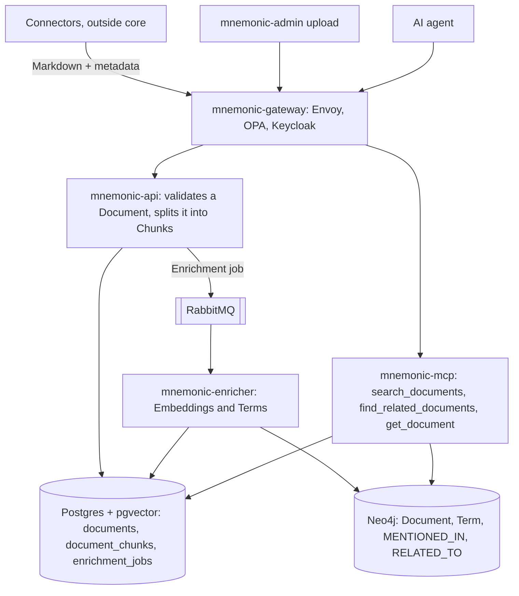
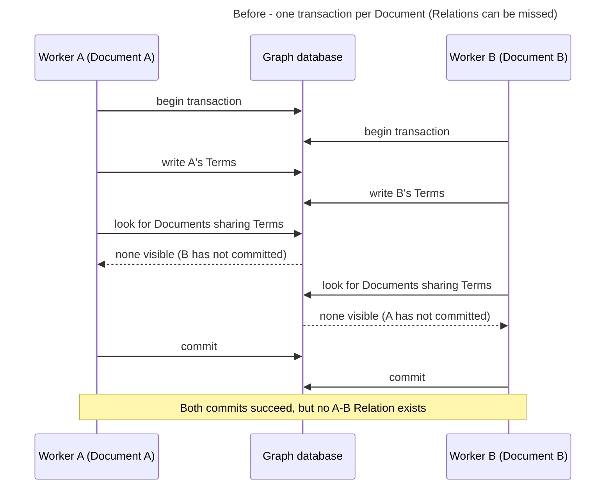
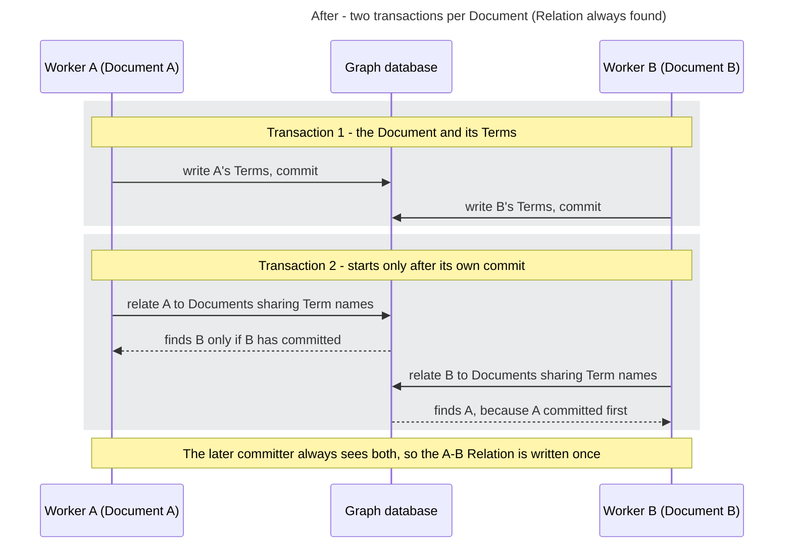
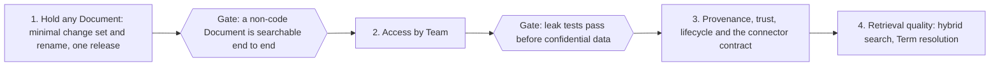

# Mnemonic: From Coding Patterns to Any Knowledge

Oct 17, 2026 · @Jeremy Johnson

## Bottom line

Mnemonic can hold any kind of document with changes to the existing core only: a handful of small fixes plus one rename of "pattern" to "document" through the engine and the MCP tools. The storage model is already generic: `patterns` and `pattern_chunks` hold Markdown, `entity_type` is a free kebab-case value, and `language` and `domain` columns already default to empty (`db/postgres` migration 000009). What keeps it code-only is validation, the chunking fallback, the extraction prompt and the wording agents read. `entity_type` becomes Kind: `policy`, `runbook`, `faq`, `contract`.

## Minimal change set

The repo names below are the pre-monorepo repositories. In this monorepo `mnemonic-api`, `mnemonic-mcp` and `mnemonic-enricher` are the packages under `src/internal/<service>/`, `mnemonic-dbs` is `db/`, and `mnemonic-gateway` is `gateway/`. `mnemonic-admin`, `mnemonic-patterns` and `mnemonic-docs` are not part of this checkout. Function and file names are checked against the current code.

This is everything required to hold more than patterns. No new services, no connectors, no new tables.

| Repo | Change | Why |
| --- | --- | --- |
| mnemonic-api | Make Domain and Language optional; still check the vocabulary when one is given (handlers/patterns `validatePatternFields`) | A policy has no programming language; today the request fails with REQUIRED |
| mnemonic-api | Allow empty `vocabulary.languages` and `vocabulary.domains` to mean any value instead of refusing to start (config `VocabularyConfig.validate`) | A non-code deployment should not have to invent a list |
| mnemonic-api | When a Document has no chunk markers, split it at headings and cap each Chunk by size, instead of making the whole Document one Chunk (`splitIntoChunks`, service/pattern/service.go:140) | Business documents have no markers, and a large one becomes a single Chunk past the embedding model's input limit. Chunk markers keep working as an override |
| mnemonic-api | Make the 100,000-byte content limit configurable, and reject inline base64 images | Handbooks exceed the limit; base64 images fill it and add noise to Embeddings |
| mnemonic-api, mnemonic-mcp | Add a Kind filter to REST search and `search_documents` | Lets an agent search only policies, only runbooks, and so on |
| mnemonic-enricher | Rewrite the extraction prompt from "programming concepts / technologies / practices" to the Term categories `topic`, `entity` and `practice` (`parseConcepts`, service/openai/extraction.go) | Today a sales playbook yields programming-flavoured or empty Terms, so Relations are poor |
| mnemonic-mcp | Rename the tools to `search_documents`, `find_related_documents` and `get_document`, with parameter `document_id`; descriptions and result headers say Documents and Chunks; results show Kind (mcpserver/tools.go, input.go, format.go) | Agents choose tools from these descriptions, and "coding patterns" steers them away from business questions |
| mnemonic-admin | Import: drop the required `## Overview` and chunk-marker checks and the required Language and Domain; add a Kind filter (features/import, features/patterns) | The UI rejects any non-pattern file today |
| mnemonic-integration-tests | Load one non-code Document (for example a leave policy) end to end and search it; update the stub's extraction reply | Proves the path works |
| mnemonic-docs | Update the schema reference, concept doc, glossary and KM-1 to say Documents of any Kind, using the vocabulary below | The docs define Mnemonic as a coding-pattern store |

## Renaming "pattern" to "document"

The word appears about 5,400 times in roughly 150 source files across api, enricher, mcp, dbs, admin and the integration tests. It is mechanical, but the services share one schema and the gateway names the tools and paths, so it has to ship as one coordinated release.

| Layer | Today | Renamed |
| --- | --- | --- |
| MCP tools | `search_patterns`, `find_related_patterns`, `get_pattern`, `pattern_id` | `search_documents`, `find_related_documents`, `get_document`, `document_id` |
| REST API | `/v1/api/patterns`, `/patterns/search`, `/patterns/{id}/chunks` | `/v1/api/documents/...`, keeping `/patterns` as an alias for one release so mnemonic-patterns' `load.sh` keeps working |
| Go code | packages `pattern`; types `Pattern`, `PatternChunk`, `patternService`; `Concept` in the enricher | packages `document`; types `Document`, `Chunk`; `Term` |
| PostgreSQL | tables `patterns`, `pattern_chunks`; columns `pattern_id`, `entity_type`, `related_patterns`, `section_title`; `enrichment_jobs.pattern_id` | `documents`, `document_chunks`; `document_id`, `kind`, `document_references`, `heading`, via a new migration 000011. `references` alone is a reserved word in SQL, hence the prefix |
| Neo4j | labels `Pattern`, `Concept`; property `Concept.type`; constraints `pattern_id_unique`, `concept_name_unique`; indexes `pattern_name_index`, `pattern_content_fulltext`, `concept_type_index`, `concept_name_fulltext` | labels `Document`, `Term`; property `Term.category`; matching constraint and index names, via a new Cypher migration that relabels existing nodes |
| Chunk marker | `[//]: pattern` | `[//]: chunk`, still accepting `[//]: pattern` for one release so existing files load unchanged |
| Gateway | OPA `tool_scopes` lists the three tool names; api.rego matches `/v1/api/patterns`; scopes `patterns:read`, `patterns:write`, `patterns:admin` in the Keycloak realm (`gateway/opa/policy`, `gateway/keycloak/realm-mnemonic.json`) | The same edits, with scopes `documents:read`, `documents:write`, `documents:admin`. Without them OPA denies the new names, because anything unlisted is denied |
| Admin UI | API client paths, labels, "Import pattern" | Documents throughout |

The docs' migration rule (never rename directly; add, copy, then drop) exists for zero-downtime upgrades. The images are still `v1.0.0-dev` with no outside users, so a direct `ALTER TABLE ... RENAME` in 000011 is the simpler choice now; after a real release the three-step route applies.

## How it fits together

After the minimal change set and the rename, the services and their order are the same as today. Only the words and the validation change.

Read it top down: content enters through the gateway, mnemonic-api chunks it, the enricher embeds the Chunks and extracts Terms, and mnemonic-mcp serves search and Relations to agents.

Outbound calls to OpenAI go through one egress proxy, not from the services themselves. The services sit on a network with no route to the internet and point `MNEMONIC_OPENAI_BASE_URL` at an Envoy egress container. That container forwards only `POST /v1/embeddings` and `POST /v1/chat/completions` to `api.openai.com`, refuses everything else, and adds the API key itself, so the key exists only in that one container. The same pattern carries over to Azure OpenAI or Bedrock by changing the proxy's upstream, and to a Kubernetes egress gateway in production.

### Enrichment with concurrent workers

The enricher runs more than one worker, so two related Documents can be enriched at the same moment, as they are in a first bulk load. The graph write used to be one transaction per Document. Under READ COMMITTED, which both Neo4j and AWS Neptune use, a transaction cannot see another worker's uncommitted Terms, so each worker looked for related Documents before the other had committed and neither Relation was written. The commits succeeded and nothing logged an error.

The fix does not depend on locks or on any one database's concurrency behavior. It splits the write into two transactions: the first commits the Document and its Terms, and the second computes the Relations, starting only after the first has committed. Whichever worker commits its first transaction last is guaranteed to see the other's committed Terms.

Two details make this hold without a uniqueness constraint, which Neptune does not offer. Shared Terms are matched by name, not by graph node, because two workers that create the same Term at the same moment each create their own node. And each Relation is written once, in one fixed direction, from the Document with the lower id to the one with the higher id, so two workers computing the same pair cannot create mirrored edges. If the second transaction fails, the Document keeps its new Terms and its old Relations until the enrichment job retries.

#### If contention shows up later

The two-transaction write keeps the graph correct, so nothing below is needed to hold more than patterns. It would only matter if measurements show real contention, for example many conflict retries on Neptune or slow bulk loads.

- **A single graph-writing stage (preferred).** The slow work in Enrichment is the OpenAI calls, which take seconds. The graph write takes milliseconds. So workers would keep embedding Chunks and extracting Terms in parallel, then publish a small "write to graph" message, and one consumer would apply those messages one at a time. On RabbitMQ that is a single-active-consumer queue; on SQS it is a FIFO queue with one message group. It needs no AI and no database-specific code. It changes the job lifecycle: Enrichment status needs an in-between state (embedded, graph pending), and the graph stage needs retry limits so a poison message cannot block the single consumer. The graph write becomes a single lane, so throughput there needs watching in a very large load. The two-transaction write stays as a second line of defense.
- **Partitioning by Domain (lighter).** Route Documents with the same Domain to the same worker, through a consistent-hash exchange on RabbitMQ or the Domain as the SQS FIFO message group id. It lowers contention but cannot remove it, because related Documents do not always share a Domain and Terms are only known after extraction.
- **Not recommended: an AI agent that routes Documents by topic.** It adds an AI call per Document and would need SB-1 amended. Labels would vary from one Document to the next, which defeats the point, and it still would not guarantee that related Documents land together.

## Ubiquitous vocabulary (proposed)

One word per idea, used identically in code, schema, graph, API, MCP tools, admin UI and docs. Each term has three parts. **Is** says what it is, **Is not** names the ideas it must not be confused with, and **Rules** states the invariants. Rules marked *today* are checked against `db/` and the enricher's Cypher; rules marked *proposed* are new.

### Content

**Document** (replaces pattern)

- Is: one unit of knowledge submitted through the API. It has a name, a kind and Markdown content, plus an optional description, domain, language, tags, version and references.
- Is not: a Chunk, which is what search returns, or a file, which a connector converts into a Document before pushing it.
- Rules: the name is unique across the deployment (*today*). Content is Markdown with a configurable size limit (*proposed*; it is 100 KB today). A Document has one or more Chunks. A Document has exactly one graph node with the same id (*today*).

**Kind** (replaces entity\_type)

- Is: the category of a Document, written in kebab-case, for example `policy`, `runbook`, `faq` or `coding-standard`.
- Is not: a Domain, which is the subject area, or a Tag, which is a free label.
- Rules: every Document has exactly one Kind. The set of kinds is open and not checked against a list. Search can filter on it (*proposed*).

**Domain**

- Is: the business area a Document belongs to, for example `finance`, `engineering` or `legal`.
- Is not: a Term category. The enricher's old concept type `domain` is retired so this word has one meaning.
- Rules: a Document has zero or one Domain (*proposed*; it is required today). The set is open.

**Language**

- Is: the programming language of the code a Document describes.
- Is not: the natural language the Document is written in.
- Rules: a Document has zero or one Language, and it is empty for non-code Documents (*proposed*; it is required today).

**Tag**

- Is: a free label an author attaches to a Document.
- Is not: a Kind, a Domain or a Term. Authors choose Tags; the enricher finds Terms.
- Rules: a Document has zero or more Tags, stored as a JSON array (*today*).

**Version**

- Is: a version string the author supplies for a Document's content.
- Is not: a revision counter kept by Mnemonic.
- Rules: a Document has zero or one Version, and core stores it as given (*today*).

**Reference** (replaces related\_patterns)

- Is: a link an author declares from one Document to another, by name.
- Is not: a Relation, which the enricher computes.
- Rules: a Document has zero or more References (*today*, stored as a JSON array).

### Retrieval units

**Chunk** (replaces pattern chunk and section)

- Is: a contiguous slice of one Document's content that is embedded and searched on its own.
- Is not: a Document. It is also not necessarily a Markdown section, because a long section can be split by size (*proposed*).
- Rules: a Chunk belongs to exactly one Document and is deleted with it (*today*). Chunks are ordered by index (*today*).

**Heading** (replaces section\_title)

- Is: the title of a Chunk, taken from the Markdown heading the Chunk starts under.
- Is not: the Document's name.
- Rules: every Chunk has exactly one Heading (*today*).

**Chunk marker** (replaces decorator)

- Is: the line `[//]: chunk` in a Document's content, which forces the next Chunk to start there.
- Is not: visible content, because it does not render in Markdown.
- Rules: it is optional. Without markers, Chunks split at headings and size (*proposed*). The legacy marker `[//]: pattern` is accepted for one release (*proposed*).

**Embedding**

- Is: the vector for one Chunk, with 2000 dimensions from text-embedding-3-large.
- Is not: a Document-level vector. That column was dropped in migration 000005.
- Rules: a Chunk has zero or one Embedding, and has zero until Enrichment succeeds (*today*).

### Processing

**Enrichment**

- Is: the asynchronous processing of a Document that embeds its Chunks and extracts its Terms.
- Is not: ingestion, which is mnemonic-api accepting and chunking the Document.
- Rules: a Document and each of its Chunks have an Enrichment status of `pending`, `enriched` or `failed` (*today*).

**Enrichment job**

- Is: one queued request to enrich one Document.
- Is not: a message on the queue, which only carries the job's id.
- Rules: a Document has at most one job that is pending or processing (*today*, unique index). A job is attempted up to its maximum, which defaults to 3 (*today*).

### Graph

**Term** (replaces Concept)

- Is: a named idea, system, product or practice that the enricher finds in Documents, stored as the graph node `:Term` (today `:Concept`).
- Is not: a Tag, which an author sets, and not OKF's Concept, which is a whole document and maps to our Document.
- Rules: a Term is unique by its normalized lowercase name (*today*). It has exactly one category. It exists only in the graph (*today*).

**Term category** (replaces concept type)

- Is: one of `topic`, `entity` or `practice`.
- Is not: a Domain. The old values `domain` and `technology` are retired.
- Rules: the set is closed. Changing it means changing the enricher's prompt (*proposed*).

**Mention**

- Is: the fact that a Term appears in a Document, stored as the graph edge `MENTIONED_IN` from the Term to the Document.
- Is not: a Reference.
- Rules: there is at most one Mention per Term and Document pair. Mentions are replaced on each Enrichment (*today*).

**Relation**

- Is: a computed link between two Documents that share Terms, stored as the graph edge `RELATED_TO` with a similarity score.
- Is not: a Reference, which an author declares, and not a link between Terms.
- Rules: a Relation exists only above a minimum similarity. A Document's Relations are recomputed on each Enrichment (*today*).

### Access

**Team**

- Is: the group a caller belongs to, to be identified by the gateway (*proposed*).
- Is not: an owner field on a Document. Core stores no team today, and the gateway has no Team concept: it authorizes by token scope (`mcp:read`, `patterns:write` and so on).
- Rules: Team-based authorization does not exist yet (the security architecture document describes an `X-Team-ID` header that `gateway/` does not set). Per-Document ownership is a later decision.

### MCP verbs

- `search_documents` returns Chunks ranked by Embedding similarity and grouped by Document.
- `find_related_documents` returns the Documents linked to one Document by Relations.
- `get_document` returns one Document with its full content.

Retired words: pattern, entity\_type, section, section\_title, decorator, related\_patterns, Concept (now Term, so the word is free for OKF's sense), and the concept types domain and technology.

## Mnemonic and OKF

OKF v0.2 ([SPEC.md](https://github.com/GoogleCloudPlatform/knowledge-catalog/blob/main/okf/SPEC.md)) is a file format: a directory of Markdown files with YAML frontmatter, one file per concept, usually in Git. Its stated non-goals include prescribing storage, serving or query infrastructure (§1). Those are exactly what Mnemonic is, so the two do not compete. OKF can be one input format, and Mnemonic the service that indexes, searches and serves it.

### What Mnemonic adds that OKF leaves out

- **Semantic search.** OKF offers navigation through `index.md` files and links. It has no chunks and no embeddings.
- **An inferred graph.** OKF links are untyped and hand-written (§6.1). Mnemonic computes Terms, Mentions and Relations during Enrichment.
- **Access control.** OKF's trust tiers are "advisory signals, not access control" (§5.3). Mnemonic authorizes by token scope at the gateway.
- **Serving.** Agents call MCP tools instead of cloning and parsing a bundle.

### What OKF has that Mnemonic lacks

- **Provenance.** `sources`, with per-source signals `author`, `usage_count` and `last_modified` (§5.1).
- **Trust.** `generated` and `verified`, from which a consumer derives a trust tier: unverified, machine-confirmed or human-reviewed (§5.2, §5.3).
- **Lifecycle.** `status` (`draft`, `stable`, `deprecated`) and `stale_after` (§5.4, §5.5).
- **Attested computations.** A sanctioned query an agent may only parameterize, checked by a deterministic attester (§10). The attester runs on the consumer side, which fits MCP staying read-only.

### Mapping an OKF bundle into Mnemonic

| OKF | Mnemonic | Note |
| --- | --- | --- |
| Bundle | none today | Maps to a Collection if collections are added later. |
| Concept (one `.md` file) | Document | The two vocabularies collide here, see below. |
| Concept ID (file path) | Document name | Paths are unique within a bundle, so the uniqueness rule holds. |
| `type` | Kind | OKF types are free text such as `BigQuery Table`. Kind is kebab-case, so the connector normalizes it. |
| `title`, `description`, `tags` | name, description, Tags | Direct. |
| `resource` | none today | Candidate new optional field: Resource. |
| Link | Reference | Both are author-declared and directed. OKF tolerates broken links, so References must too. |
| `sources`, `generated`, `verified`, `status`, `stale_after` | none today | Candidate optional metadata on Document. |
| `index.md`, `log.md` | not ingested | Reserved files, not concepts (§3.1). |

The import itself is a connector outside core: it reads the bundle and pushes each concept file to mnemonic-api.

### Vocabulary collision

In OKF a **Concept** is a whole document. Decided (Jeremy, 2026-10-19): Mnemonic renames its extracted Concept to **Term**, so OKF's Concept maps to Document with no ambiguity. The Neo4j label `:Concept` becomes `:Term` in the same release as the pattern rename.

## Constraints from mnemonic-docs

Decisions already in mnemonic-docs/docs/ that shape both the minimal set and the later work.

| Already in the docs | Where | Effect |
| --- | --- | --- |
| Access is enforced at the infrastructure layer; Envoy injects `X-User-ID`, `X-Team-ID` and `X-User-Roles` | requirements SB-4; system/01-security SEC-ADR-001 to 003 | Access by Team (later) uses `X-Team-ID` as the key. OPA cannot filter rows, so services must add the Team filter to every query, and SB-4 needs a sentence allowing that |
| MVP 3 to 5 replace Neo4j with AWS Neptune and RabbitMQ with SQS | diagrams/03 to 05, system/02 | Graph changes, including the `:Term` relabel, must stay in openCypher that Neptune runs. Keyword search belongs in Postgres, not the graph |
| AI calls are limited to embeddings and extraction | requirements SB-1 | A rerank model would need SB-1 amended (open decision 4). Image description happens in connectors, outside core, so it does not touch SB-1 |
| MCP must be read-only | requirements SE-4 | Unchanged. OKF attestation runs on the consumer side, which fits |
| Never rename a column directly; add, copy, then drop | system/04-data-architecture, Migration Strategy | The rename uses a direct `ALTER TABLE ... RENAME` while the images are v1.0.0-dev; after a real release the three steps apply |
| Changing the embedding prefix (name, tags and heading) forces re-embedding every Chunk | design/pattern-processing, Enriched Text Format | The rename keeps the prefix's values, so it needs no re-embedding. Adding Kind to the prefix later would mean one full re-enrichment |
| JSONB document model with CRC-64 change detection, designed but never built | ADR-003, design/data-storage | Reuse it for provenance, trust and lifecycle metadata and for selective re-embedding (later) |
| Blended ranking 0.7 vector + 0.3 graph is planned; scale assumed at hundreds to tens of thousands of patterns, one team per deployment | system/05, design/pattern-processing; requirements Assumptions | Fold the blend into hybrid search (later). Business corpora break both assumptions, so requirements need restating |

mnemonic-patterns' `load.sh` is already an out-of-core loader that only calls the API, which is the connector model. The docs (concept.md, the guides, the glossary, KM-1 and ADR-001) define Mnemonic as a coding-pattern store, and some of them still describe Envoy and OPA as unbuilt although `gateway/` exists.

## Later, if you want it

Nothing here is needed to hold more than patterns. It is what a large, multi-team business deployment would eventually want. Every item uses the vocabulary above; a word marked *new term* gets a glossary entry before it is built.

| Item | Today | What it adds | Why |
| --- | --- | --- | --- |
| Access by Team | The gateway authorizes per token scope, not per Team, and core stores no Team, so every authorized caller sees every Document (`gateway/opa/policy/api.rego`, `mcp.rego`) | An owning Team on each Document and Chunk, filtered in every pgvector and Cypher query | Required before loading anything confidential |
| Provenance, trust and lifecycle | No source, author, verification or expiry fields | Optional Document fields modelled on OKF §5: `sources`, `generated`, `verified`, `status` and `stale_after`, stored in ADR-003's JSONB metadata | Agents can cite sources, prefer human-reviewed Documents and skip stale ones |
| Connector contract | Content arrives only by POST | A versioned push API: upsert by source system and source id, delete, list ids for reconciliation, and a connector-scoped token. An OKF importer is the natural first connector | Keeps connectors outside core |
| Hybrid search | Vector-only over Chunks; keyword search covers only name and description, in English | Full-text index on Chunk text fused with vector results, then the planned graph blend; pgvector iterative scans so filtered searches return full pages | Exact strings such as product codes and policy numbers are found |
| Term resolution and typed Relations | One global Term per lowercase name; only `MENTIONED_IN` and `RELATED_TO` | Alias resolution; typed links such as `OWNS`, `SUPERSEDES` and `PART_OF`, kept in portable openCypher | Better `find_related_documents` |
| Selective re-embedding | Every update re-embeds every Chunk | Hash each Chunk and re-embed only changed ones | Matters once connectors sync nightly |
| Pluggable models | OpenAI-compatible `base_url` in api, enricher and mcp | Provider choice (Azure OpenAI, Bedrock, local), with the embedding model recorded per Chunk | Businesses often mandate a provider |
| Collection *(new term)* | None | A named group of Documents, such as one OKF bundle, used for filtering and access | Maps OKF bundles and scopes access |
| Admin UI | Pattern-centred screens | Kind and Domain filters, ingestion status per source, an access editor, a search tester with citations | Operators manage non-code content |

## Roadmap

Phase 1 is the only one required. Each later phase is usable on its own, and nothing confidential is loaded before Access by Team exists.

## Decisions

Settled (Jeremy, 2026-10-18 and 2026-10-19): connectors stay outside core; mnemonic-api remains the only way in; only existing core repos change; **Document** replaces pattern and **Term** replaces Concept, through the engine, schema, graph, MCP tools and gateway in one release. The MVP has no Document-level access control: Envoy and OPA authenticate callers and allow or deny them per tool and path, and any caller who passes the gateway can read every Document, so load only content that every authorized user may see. Access by Team (Phase 2) adds the row filter.

Still open. My default is in bold.

1. **Single business per deployment**, with Teams and later Collections, or true multi-tenant with a tenant id on every row and node.
2. **Markdown and plain text only at the API**, with connectors converting everything else, or the API also accepting HTML.
3. **Stay on the planned graph path** (Neo4j now, Neptune at MVP 3) with graph work kept to portable openCypher, or fold the graph into Postgres edge tables and drop the Neptune step.
4. **No rerank model** (keyword and vector fusion plus the graph blend, SB-1 unchanged), or amend SB-1 to allow a reranking model.
