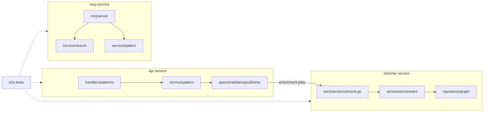

# Requirements Traceability Matrix

> Back to [Design Index](README.md)

**Code paths:** a path written as `internal/<dir>/...` is relative to the service's source directory, `src/internal/<service>/`: drop the leading `internal/`. For example, `internal/metrics/tools.go` in the mcp service is `src/internal/mcp/metrics/tools.go`.

This matrix maps each requirement to the architecture and design documents that address it, and then to the code and tests that implement it today.

- [Implementation Status](#implementation-status) — where each requirement lives in code (the api service v0.5.0, the enricher service v0.5.0, the mcp service v0.6.0, `develop`) and which tests cover it
- [Architecture References](#knowledge-management) — the design documents behind each requirement

## Implementation Status

Test suites:

- **Unit** — `*_test.go` next to the code (`make tests-unit` locally, run with `-race` in each Docker build). There is no Go integration tier; database-backed behavior is covered by the end-to-end suite
- **End-to-end** — the Python black-box suite in `tests/integration/tests/` (`test_stack_flows.py`, `test_smoke_images.py`, `test_mcp_edge.py`, `test_enricher_failures.py`, `test_api_behavior.py`, `test_api_list_and_limits.py`, `test_api_concurrency.py`, `test_graph_behavior.py`, `test_search_and_lifecycle.py`), run by each `build/<service>/<service>.build.sh` against the image just built, the other services' `latest-dev` images and an OpenAI stub

Status: **Implemented**, **Partial** (see note), **Not implemented**, or **Post-MVP** (deliberately deferred).

| Req  | Status          | Code                                                                                                                                                                                                                                                         | Tests                                                                                                                                                                                                                                                                                                                                                          |
| ---- | --------------- | ------------------------------------------------------------------------------------------------------------------------------------------------------------------------------------------------------------------------------------------------------------ | -------------------------------------------------------------------------------------------------------------------------------------------------------------------------------------------------------------------------------------------------------------------------------------------------------------------------------------------------------------- |
| KM-1 | Implemented     | api `internal/handlers/patterns/patterns.go` (`Create`, `validatePatternFields`); api `internal/service/pattern/service.go`                                                                                                                                  | api `internal/handlers/patterns/patterns_test.go` (`TestPatternCreate_*`, `TestPatternWrite_*`); api `internal/service/pattern/service_test.go` (`TestCreate`); e2e `test_api_behavior.py::test_create_and_get_carry_the_submitted_fields`, `test_stack_flows.py::test_pattern_flows_from_api_to_mcp`                                                          |
| KM-2 | Implemented     | api `internal/service/search`; mcp `internal/service/search`, `internal/repository/chunk/repository.go` (`FindSimilar`); enricher `internal/service/enrichment/service.go` (chunk embeddings)                                                                | api and mcp `internal/service/search/service_test.go`; e2e `test_search_and_lifecycle.py::test_search_orders_by_similarity_and_applies_the_threshold`, `::test_search_filters_by_language_and_tags`, `test_stack_flows.py::test_pattern_flows_from_api_to_mcp`, `::test_update_reenriches_pattern`                                                             |
| KM-3 | Implemented     | enricher `internal/repository/graph/repository.go` (`SyncPattern`: `MENTIONED_IN`, `RELATED_TO`); mcp `internal/repository/graph`, `internal/mcpserver` (`find_related_patterns`, graph expansion in `search_patterns`)                                      | enricher `internal/repository/graph/repository_test.go`; e2e `test_graph_behavior.py` (`test_related_patterns_are_ordered_by_similarity_and_limited`, `test_update_prunes_stale_concepts_and_edges`), `test_search_and_lifecycle.py::test_search_expands_through_the_graph_and_filters_the_expansion`, `test_stack_flows.py::test_related_patterns_and_delete` |
| KM-4 | Partial         | Status per pattern and per chunk: enricher `internal/service/enrichment/service.go`; search filters `enrichment_status = 'enriched'` per chunk in mcp/api `internal/repository/chunk`                                                                        | e2e `test_api_behavior.py::test_search_excludes_pattern_until_enriched`, `test_mcp_edge.py::test_get_pattern_pending_returns_markdown_with_pending`, `::test_find_related_without_graph_node_says_none`, `test_search_and_lifecycle.py::test_update_resets_an_enriched_pattern_to_pending`                                                                     |
| KM-5 | Implemented     | enricher `internal/enricher/enrichment.go` (15s retry sweep, maintenance), `internal/repository/enrichmentjob/repository.go` (`MarkFailed`, `ClaimDue`); `enrichment_error` returned by api `GET /v1/api/patterns/{id}`                                      | e2e `test_stack_flows.py::test_enricher_retries_failed_job`, `test_enricher_failures.py::test_terminal_failure_marks_job_failed`, `test_api_behavior.py::test_failed_enrichment_reports_an_error`; enricher `internal/enricher/enrichment_test.go` (`TestWorkerRunsJobsDueForRetry`)                                                                           |
| KM-6 | Not implemented | No agent field, storage, or filter in any service (the `db/` schema defines unused agent tables)                                                                                                                                                             | —                                                                                                                                                                                                                                                                                                                                                              |
| AD-1 | Implemented     | api `internal/handlers/patterns/patterns.go` (`RegisterRoutes`: `POST /v1/api/patterns`, `PUT` and `DELETE /v1/api/patterns/:id`); api `internal/server/server.go`                                                                                           | api `internal/handlers/patterns/patterns_test.go` (`TestPatternCreate_Success`, `TestPatternUpdate_Success`, `TestPatternDelete_Success`); e2e `test_api_behavior.py::test_put_replaces_description_and_tags`, `test_api_list_and_limits.py::test_delete_of_unknown_id_is_404`                                                                                 |
| AD-2 | Implemented     | api `internal/handlers/respond.go` (RFC 7807 `ProblemDetail`, `FieldError`)                                                                                                                                                                                  | api `internal/handlers/respond_test.go`; api `internal/handlers/patterns/patterns_test.go` (`TestPatternWrite_ValidationRejects`); e2e `test_api_list_and_limits.py::test_duplicate_name_is_rejected`, `::test_content_limit_is_100000_characters`                                                                                                             |
| AD-3 | Implemented     | api `internal/handlers/patterns/patterns.go` (`List`: `tags`, `search`, `language`, `domain`, `entity_type`, cursor); api `internal/repository/pattern/repository.go` (`List`)                                                                               | api `internal/handlers/patterns/patterns_test.go` (`TestPatternList_*`); e2e `test_api_behavior.py::test_list_filters`, `::test_list_pagination_walks_every_page_once`, `test_api_list_and_limits.py::test_search_matches_a_word_only_in_the_name`, `::test_unmatched_tag_lists_nothing`                                                                       |
| AD-4 | Implemented     | api `internal/service/pattern/service.go` (`Create`, `publishJob`), `internal/queue/rabbitmq/publisher.go`; `202 Accepted` in `handlers/patterns`                                                                                                            | api `internal/service/pattern/service_test.go` (`TestCreate`, `TestPublishJobError`); e2e `test_search_and_lifecycle.py::test_failed_create_frees_the_name`, `::test_created_pattern_has_one_job_per_chunk_with_no_attempts`, `test_stack_flows.py::test_pattern_flows_from_api_to_mcp`                                                                        |
| AD-5 | Not implemented | No retry endpoint; retries are automatic (KM-5)                                                                                                                                                                                                              | —                                                                                                                                                                                                                                                                                                                                                              |
| OB-1 | Partial         | api `internal/middleware/observability.go` (per-request `request completed` log); mcp logs each tool call in `internal/mcpserver/handlers.go`, not each `/mcp` HTTP request                                                                                  | api `internal/server/observability_test.go` (`TestProductionHTTPObservability`), `internal/middleware/observability_test.go`                                                                                                                                                                                                                                   |
| OB-2 | Implemented     | `internal/health/health.go` and `internal/handlers/operations` in each service (`GET /health`, `--health` probe)                                                                                                                                             | `internal/health/health_test.go` in each service; `src/cmd/api/main_test.go` (`--health`); e2e `test_stack_flows.py::test_services_healthy`                                                                                                                                                                                                                    |
| OB-3 | Implemented     | `internal/metrics` in each service (Prometheus on `:9090/metrics`); mcp `internal/metrics/tools.go`                                                                                                                                                          | `internal/metrics/*_test.go` in each service; e2e `test_smoke_images.py::test_metrics_endpoint`                                                                                                                                                                                                                                                                |
| OB-4 | Implemented     | enricher `internal/enricher/enrichment.go`, `internal/service/enrichment/service.go`; enricher `internal/metrics/jobs.go`                                                                                                                                    | enricher `internal/enricher/enrichment_test.go`, `internal/metrics/jobs_test.go`                                                                                                                                                                                                                                                                               |
| SE-1 | Implemented     | No auth middleware in api `internal/server`, mcp `internal/mcpserver/server.go`                                                                                                                                                                              | Every call in the e2e suite (`tests/integration/tests`) is made without credentials; no test asserts the absence of auth as such                                                                                                                                                                                                                               |
| SE-2 | Implemented     | `gateway/`: Envoy JWT verification (`gateway/envoy/envoy.yaml`), OPA policy (`gateway/opa/policy/*.rego`), Keycloak dev realm (`gateway/keycloak/realm-mnemonic.json`); deployed in front of the services by `deploy/docker-compose.yaml` and the Helm chart | `gateway/opa/policy/api_test.rego`, `mcp_test.rego`; `gateway/test/e2e/gateway_test.go`                                                                                                                                                                                                                                                                        |
| SE-3 | Implemented     | By design: no user, credential, or session tables or fields in any service                                                                                                                                                                                   | —                                                                                                                                                                                                                                                                                                                                                              |
| SE-4 | Implemented     | mcp `internal/mcpserver/tools.go` (only `search_patterns`, `find_related_patterns`, `get_pattern`); mcp has no write code                                                                                                                                    | mcp `internal/mcpserver/tools_test.go` (`TestAdvertisedToolsHaveDescriptions`), `server_test.go` (`TestServerDiscover`)                                                                                                                                                                                                                                        |
| SE-5 | Not implemented | —; the gateway's Envoy config defines no TLS listener                                                                                                                                                                                                        | —                                                                                                                                                                                                                                                                                                                                                              |
| SE-6 | Implemented     | `internal/config/config.go` in each service (`MNEMONIC_*` env vars, config file)                                                                                                                                                                             | `internal/config/config_test.go` in each service                                                                                                                                                                                                                                                                                                               |
| DP-1 | Partial         | Local: Docker images, `deploy/docker-compose.yaml` and the Helm chart `deploy/helm/mnemonic`; production hardening (TLS, managed data stores) is Post-MVP                                                                                                    | e2e suite runs the images under Docker Compose (`tests/integration/docker-compose.yaml`); the Helm chart is exercised by `deploy/test/k8s-e2e.sh`, run by the owner                                                                                                                                                                                            |
| DP-2 | Implemented     | All state in PostgreSQL/Neo4j/RabbitMQ; mcp uses stateless Streamable HTTP (`internal/mcpserver/server.go`); enricher claims jobs with `FOR UPDATE SKIP LOCKED` (`internal/repository/enrichmentjob/repository.go`)                                          | enricher `internal/enricher/enrichment_test.go` (`TestMultipleWorkersConcurrency`); `internal/repository/enrichmentjob/repository_test.go`                                                                                                                                                                                                                     |
| DP-3 | Not implemented | No startup schema-version check; services run no migrations                                                                                                                                                                                                  | —                                                                                                                                                                                                                                                                                                                                                              |
| SB-1 | Implemented     | Embeddings (all three services) and concept extraction (enricher) via `openai.base_url`                                                                                                                                                                      | The e2e suite runs entirely against `tests/openai-stub/`                                                                                                                                                                                                                                                                                                       |

## Architecture References

## Knowledge Management

| Req  | Description                                                   | Architecture References                                                                                                                                                                                                                                                                                                                                                                       |
| ---- | ------------------------------------------------------------- | --------------------------------------------------------------------------------------------------------------------------------------------------------------------------------------------------------------------------------------------------------------------------------------------------------------------------------------------------------------------------------------------- |
| KM-1 | Store team knowledge as named, searchable patterns            | [00: ADR-001](architecture/system/00-architectural-decisions.md#adr-001) · [04: Patterns](architecture/system/04-data-architecture.md#patterns) · [04: PostgreSQL Schema](architecture/system/04-data-architecture.md#postgresql-schema)                                                                                                                                                      |
| KM-2 | Semantic search over patterns by meaning                      | [00: ADR-004](architecture/system/00-architectural-decisions.md#adr-004) · [04: PGVector Configuration](architecture/system/04-data-architecture.md#pgvector-configuration) · [05: Query Flow: Pattern Search Pipeline](architecture/system/05-database-integration-flow.md#query-flow-pattern-search-pipeline) · [03: MCP Tools](architecture/system/03-communication-patterns.md#mcp-tools) |
| KM-3 | Expose relationships between patterns                         | [04: Neo4j Graph Model](architecture/system/04-data-architecture.md#neo4j-graph-model) · [05: The Three Storage Layers](architecture/system/05-database-integration-flow.md#the-three-storage-layers) · [03: MCP Tools](architecture/system/03-communication-patterns.md#mcp-tools)                                                                                                           |
| KM-4 | Track enrichment state; only enriched patterns are searchable | [00: ADR-004](architecture/system/00-architectural-decisions.md#adr-004) · [04: Patterns](architecture/system/04-data-architecture.md#patterns) · [05: Data Flow: Pattern Creation and Enrichment](architecture/system/05-database-integration-flow.md#data-flow-pattern-creation-and-enrichment)                                                                                             |
| KM-5 | Retry failed enrichment; surface errors to admins             | [00: ADR-004](architecture/system/00-architectural-decisions.md#adr-004) · [04: Enrichment Jobs](architecture/system/04-data-architecture.md#enrichment-jobs) · [03: Admin Operations](architecture/system/03-communication-patterns.md#admin-operations)                                                                                                                                     |
| KM-6 | Associate patterns with agents, with relevance scores         | [04: Entity Relationship Diagram](architecture/system/04-data-architecture.md#entity-relationship-diagram) · [04: Neo4j Graph Model](architecture/system/04-data-architecture.md#neo4j-graph-model)                                                                                                                                                                                           |

## Administration

| Req  | Description                                           | Architecture References                                                                                                                                                                                                                                                                                 |
| ---- | ----------------------------------------------------- | ------------------------------------------------------------------------------------------------------------------------------------------------------------------------------------------------------------------------------------------------------------------------------------------------------- |
| AD-1 | Expose admin API for all write operations             | [00: ADR-002](architecture/system/00-architectural-decisions.md#adr-002) · [02: Component Breakdown](architecture/system/02-system-architecture.md#component-breakdown) · [03: Admin Operations](architecture/system/03-communication-patterns.md#admin-operations)                                     |
| AD-2 | Return structured error responses                     | [03: Error Handling](architecture/system/03-communication-patterns.md#error-handling)                                                                                                                                                                                                                   |
| AD-3 | List patterns with tag filtering and full-text search | [04: Index Strategies](architecture/system/04-data-architecture.md#index-strategies) · [04: Read Paths](architecture/system/04-data-architecture.md#read-paths)                                                                                                                                         |
| AD-4 | Accept pattern uploads, enrich asynchronously         | [00: ADR-004](architecture/system/00-architectural-decisions.md#adr-004) · [04: Write Paths](architecture/system/04-data-architecture.md#write-paths) · [05: Data Flow: Pattern Creation and Enrichment](architecture/system/05-database-integration-flow.md#data-flow-pattern-creation-and-enrichment) |
| AD-5 | Expose endpoint to retry failed enrichment            | [00: ADR-004](architecture/system/00-architectural-decisions.md#adr-004) · [04: Enrichment Jobs](architecture/system/04-data-architecture.md#enrichment-jobs)                                                                                                                                           |

## Observability

| Req  | Description                                         | Architecture References                                                                                                                                                                      |
| ---- | --------------------------------------------------- | -------------------------------------------------------------------------------------------------------------------------------------------------------------------------------------------- |
| OB-1 | Structured logs for all requests on both interfaces | [07: Structured Logging](architecture/system/07-observability-architecture.md#structured-logging)                                                                                            |
| OB-2 | Health check endpoint covering service and storage  | [06: Operational Considerations](architecture/system/06-deployment-architecture.md#operational-considerations) · [07: Metrics](architecture/system/07-observability-architecture.md#metrics) |
| OB-3 | Metrics for request rates, error rates, and latency | [07: Metrics](architecture/system/07-observability-architecture.md#metrics) · [07: Distributed Tracing](architecture/system/07-observability-architecture.md#distributed-tracing)            |
| OB-4 | Log enrichment job activity                         | [07: Structured Logging](architecture/system/07-observability-architecture.md#structured-logging) · [04: Enrichment Jobs](architecture/system/04-data-architecture.md#enrichment-jobs)       |

## Security

| Req  | Description                                               | Architecture References                                                                                                                                                                                                                                                                                                   |
| ---- | --------------------------------------------------------- | ------------------------------------------------------------------------------------------------------------------------------------------------------------------------------------------------------------------------------------------------------------------------------------------------------------------------- |
| SE-1 | MVP may operate without authentication                    | [01: Introduction](architecture/system/01-security-architecture.md#introduction) · [02: Component Interactions](architecture/system/02-system-architecture.md#component-interactions)                                                                                                                                     |
| SE-2 | Post-MVP admin API protected by infrastructure-layer auth | [01: Security Model Overview](architecture/system/01-security-architecture.md#security-model-overview) · [01: Authentication](architecture/system/01-security-architecture.md#authentication) · [01: Authorization](architecture/system/01-security-architecture.md#authorization)                                        |
| SE-3 | Never store user credentials or session tokens            | [01: Token Storage](architecture/system/01-security-architecture.md#token-storage) · [03: Security Considerations](architecture/system/03-communication-patterns.md#security-considerations) · [02: Component Breakdown](architecture/system/02-system-architecture.md#component-breakdown)                               |
| SE-4 | MCP interface is read-only                                | [00: ADR-002](architecture/system/00-architectural-decisions.md#adr-002) · [02: Claude Code Integration](architecture/system/02-system-architecture.md#claude-code-integration) · [03: Claude Code to MCP Server Communication](architecture/system/03-communication-patterns.md#claude-code-to-mcp-server-communication) |
| SE-5 | Production traffic over TLS                               | [01: Component Architecture](architecture/system/01-security-architecture.md#component-architecture) · [01: Migration Path](architecture/system/01-security-architecture.md#migration-path)                                                                                                                               |
| SE-6 | Database credentials injected from runtime environment    | [04: Security Enhancements](architecture/system/04-data-architecture.md#security-enhancements) · [06: Component Deployment](architecture/system/06-deployment-architecture.md#component-deployment)                                                                                                                       |

## Deployment

| Req  | Description                                                | Architecture References                                                                                                                                                                                                                                                      |
| ---- | ---------------------------------------------------------- | ---------------------------------------------------------------------------------------------------------------------------------------------------------------------------------------------------------------------------------------------------------------------------- |
| DP-1 | Deployable to local and production environments            | [06: Deployment Topology](architecture/system/06-deployment-architecture.md#deployment-topology) · [06: Post-MVP](architecture/system/06-deployment-architecture.md#post-mvp)                                                                                                |
| DP-2 | Stateless; all persistent state in external storage        | [02: Architecture Overview](architecture/system/02-system-architecture.md#architecture-overview) · [04: Overview](architecture/system/04-data-architecture.md#overview) · [06: Component Deployment](architecture/system/06-deployment-architecture.md#component-deployment) |
| DP-3 | Verify schema compatibility; migrations applied externally | [04: Migration Strategy](architecture/system/04-data-architecture.md#migration-strategy) · [06: Independent Deployment Pipelines](architecture/system/06-deployment-architecture.md#independent-deployment-pipelines)                                                        |

## Scope Boundaries

| Boundary                                                                      | Architecture References                                                                                                                                                                                                                                                                                                   |
| ----------------------------------------------------------------------------- | ------------------------------------------------------------------------------------------------------------------------------------------------------------------------------------------------------------------------------------------------------------------------------------------------------------------------- |
| Only external AI use is embedding generation                                  | [00: ADR-004](architecture/system/00-architectural-decisions.md#adr-004) · [02: Component Breakdown](architecture/system/02-system-architecture.md#component-breakdown) · [05: Data Flow: Pattern Creation and Enrichment](architecture/system/05-database-integration-flow.md#data-flow-pattern-creation-and-enrichment) |
| Workflow and orchestration decisions belong to the user                       | [00: ADR-001](architecture/system/00-architectural-decisions.md#adr-001) · [02: Boundary Definitions](architecture/system/02-system-architecture.md#boundary-definitions)                                                                                                                                                 |
| Tool execution and file operations happen on the client                       | [02: Boundary Definitions](architecture/system/02-system-architecture.md#boundary-definitions)                                                                                                                                                                                                                            |
| Identity management belongs to infrastructure layer                           | [01: Security Model Overview](architecture/system/01-security-architecture.md#security-model-overview) · [01: Architectural Decisions](architecture/system/01-security-architecture.md#architectural-decisions)                                                                                                           |
| All interaction is programmatic                                               | [00: ADR-002](architecture/system/00-architectural-decisions.md#adr-002) · [03: Overview](architecture/system/03-communication-patterns.md#overview)                                                                                                                                                                      |
| Primary data store is source of truth; secondary stores eventually consistent | [04: Cross-Database Consistency](architecture/system/04-data-architecture.md#cross-database-consistency) · [04: Key Takeaways](architecture/system/04-data-architecture.md#key-takeaways)                                                                                                                                 |

---

Copyright (c) 2025-2026 Jeremy K. Johnson. Licensed under FSL-1.1-ALv2; see [LICENSE](../../LICENSE).
