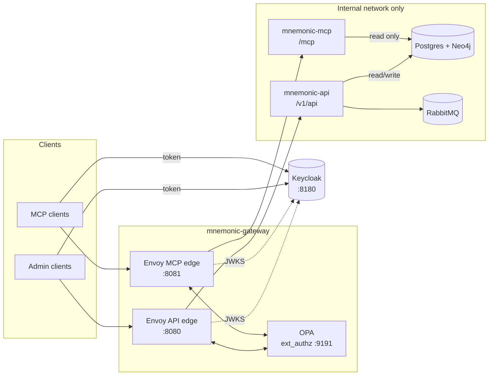

# mnemonic-gateway

Envoy and OPA gateway that handles authentication and authorization for the Mnemonic MCP server and Admin API.

`mnemonic-mcp` and `mnemonic-api` have no auth code by design. Every request reaches them through Envoy, which verifies the caller's token and asks OPA whether the request is allowed.

## How it fits



Each request goes through two checks:

1. **Authentication (Envoy `jwt_authn`).** Verifies the JWT signature against Keycloak's JWKS, plus issuer, expiry and audience. Each edge accepts only its own audience, so an API token is rejected at `/mcp` and the other way round. Envoy strips the token before forwarding.
2. **Authorization (OPA, via Envoy `ext_authz`).** Decides from the verified claims, the method, the path and, on the MCP edge, the `Mcp-Method` and `Mcp-Name` headers.

## Layout

| Path (from the repository root) | What it is |
| --- | --- |
| `gateway/envoy/envoy.yaml` | Both edges: JWT verification, ext_authz, the MCP 401/403 challenges and protected resource metadata |
| `gateway/opa/policy/` | Rego policies (`api.rego`, `mcp.rego`, entry point `main.rego`) and their tests |
| `gateway/keycloak/realm-mnemonic.json` | Dev realm: audiences, scopes, test clients and a dev user |
| `deploy/docker-compose.yaml` | Full local stack: gateway, Keycloak, both services and their data stores |
| `gateway/test/compose.stub.yaml` | The gateway with stub services, for CI and quick runs |
| `gateway/test/e2e/` | Go tests of every allow/deny case, run against either stack |

## Access rules

### API edge (`localhost:8080`, audience `mnemonic-api`)

| Request | Needs |
| --- | --- |
| `GET /version` | nothing |
| `GET /health` | any valid token |
| `GET /v1/api/patterns`, `/patterns/search`, `/patterns/{id}`, `/patterns/{id}/chunks` | `patterns:read` |
| `POST /v1/api/patterns`, `PUT /v1/api/patterns/{id}` | `patterns:write` |
| `DELETE /v1/api/patterns/{id}`, `GET /swagger/*` | `patterns:admin` |
| anything else | denied |

Scopes nest: `patterns:admin` includes `patterns:write`, which includes `patterns:read`.

### MCP edge (`localhost:8081`, audience `mnemonic-mcp`)

| Request | Needs |
| --- | --- |
| `initialize`, `ping`, `tools/list`, `notifications/*` | any valid token |
| `tools/call` `search_patterns` | `mcp:search` |
| `tools/call` `get_pattern`, `find_related_patterns` | `mcp:read` |
| `GET` / `DELETE /mcp` | any valid token |
| any other method, tool or path | denied |

Every `POST /mcp` must send `MCP-Protocol-Version: 2026-07-28`. The MCP server only checks that the `Mcp-Method` and `Mcp-Name` headers match the JSON-RPC body from that version on, so for older versions those headers can't be trusted and OPA denies the request. To allow a newer version, add it to `supported_versions` in `gateway/opa/policy/mcp.rego` once the server validates headers for it.

Unauthenticated MCP requests get `401` with `WWW-Authenticate: Bearer resource_metadata=...`, and Envoy serves the metadata at `/.well-known/oauth-protected-resource/mcp` (RFC 9728), so MCP clients can discover Keycloak and start OAuth on their own.

## Running it

Run these from the repository root. Requirements: Docker, and Go 1.24 for the e2e tests. OPA and Envoy run from pinned images, so neither needs a host install. The pins are the `openpolicyagent/opa:1.4.2-envoy-static` and `envoyproxy/envoy:v1.34.1` images of [`deploy/docker-compose.yaml`](../deploy/docker-compose.yaml).

Policy tests (`opa fmt`, `check` and `test`):

```sh
OPA=openpolicyagent/opa:1.4.2-envoy-static
docker run --rm -v "$PWD/gateway/opa/policy:/policy:ro" $OPA fmt --list --fail /policy
docker run --rm -v "$PWD/gateway/opa/policy:/policy:ro" $OPA check --strict /policy
docker run --rm -v "$PWD/gateway/opa/policy:/policy:ro" $OPA test -v /policy
```

Envoy config validation (the egress config reads the OpenAI key variable, so give it a dummy value):

```sh
docker run --rm -v "$PWD/gateway/envoy:/cfg:ro" envoyproxy/envoy:v1.34.1 envoy --mode validate -c /cfg/envoy.yaml
docker run --rm -v "$PWD/gateway/envoy:/cfg:ro" -e MNEMONIC_OPENAI_API_EMBEDDINGS_KEY=validate-only envoyproxy/envoy:v1.34.1 envoy --mode validate -c /cfg/envoy-egress.yaml
```

The gateway with stub services, which needs no Mnemonic images, databases or OpenAI key:

```sh
docker compose -f gateway/test/compose.stub.yaml up -d --build --wait --wait-timeout 240
(cd gateway/test/e2e && go test -count=1 -v ./...)
docker compose -f gateway/test/compose.stub.yaml down
```

For the full stack, which pulls the published `latest-dev` images from ghcr.io:

```sh
export MNEMONIC_OPENAI_API_EMBEDDINGS_KEY=...
docker compose -f deploy/docker-compose.yaml up -d --wait
(cd gateway/test/e2e && go test -count=1 -v ./...)
docker compose -f deploy/docker-compose.yaml down
```

To use images you built with `make build` (`make build-api`, `make build-mcp`, `make build-enricher`), point the stack at them:

```sh
MNEMONIC_API_IMAGE=ghcr.io/twistingmercury/mnemonic-api:latest \
MNEMONIC_MCP_IMAGE=ghcr.io/twistingmercury/mnemonic-mcp:latest \
MNEMONIC_ENRICHER_IMAGE=ghcr.io/twistingmercury/mnemonic-enricher:latest \
docker compose -f deploy/docker-compose.yaml up -d --wait
```

The e2e tests in `gateway/test/e2e` read these optional variables, so they can also target a stack that is not on the default ports:

| Variable | Default | Purpose |
| --- | --- | --- |
| `MNEMONIC_GATEWAY_API_URL` | `http://localhost:8080` | API edge the tests call |
| `MNEMONIC_GATEWAY_MCP_URL` | `http://localhost:8081` | MCP edge the tests call |
| `MNEMONIC_KEYCLOAK_URL` | `http://localhost:8180` | Keycloak that issues the test tokens |

The stub services of `gateway/test/compose.stub.yaml` (`gateway/test/stub`) read `MNEMONIC_STUB_NAME`, the name they answer with, and `MNEMONIC_STUB_LISTEN`, a comma-separated list of listen addresses. `gateway/test/compose.stub.yaml` sets both.

### Getting a token

The dev realm has one service client per role. The secret is the client ID followed by `-secret`.

| Client | Audience | Scopes |
| --- | --- | --- |
| `mcp-agent` | `mnemonic-mcp` | `mcp:read mcp:search` |
| `mcp-limited` | `mnemonic-mcp` | `mcp:read` |
| `api-reader` | `mnemonic-api` | `patterns:read` |
| `api-writer` | `mnemonic-api` | `patterns:write` |
| `api-admin` | `mnemonic-api` | `patterns:admin` |

```sh
TOKEN=$(curl -s localhost:8180/realms/mnemonic/protocol/openid-connect/token \
  -d grant_type=client_credentials -d client_id=api-reader -d client_secret=api-reader-secret | jq -r .access_token)
curl -H "Authorization: Bearer $TOKEN" localhost:8080/v1/api/patterns
```

For interactive MCP clients, the public client `mnemonic-mcp-client` uses authorization code with PKCE and accepts loopback redirect URIs. Sign in as `dev` / `dev`. The Keycloak admin console is at <http://localhost:8180> (`admin` / `admin`).

## Kubernetes (minikube)

The same stack runs on a local minikube cluster from the Helm chart in `deploy/helm/mnemonic/`; [`deploy/test/k8s-e2e.sh`](../deploy/test/k8s-e2e.sh) holds the end-to-end and isolation checks. The root Makefile no longer has `k8s-*` targets, so nothing automates the cluster steps today: creating the minikube profile (with a CNI that enforces NetworkPolicies, such as Calico), loading the images, creating the ConfigMaps and the Secret, and port-forwarding Envoy and Keycloak are manual. Keep your current kubectl and Helm context unchanged by naming the context in every call.

The chart expects the ConfigMaps named under `configMaps` in `values.yaml` (built from `gateway/envoy/envoy.yaml`, `gateway/envoy/envoy-egress.yaml`, `gateway/opa/config.yaml`, `gateway/opa/policy/` and `gateway/keycloak/realm-mnemonic.json`) and the Secret named in `openai.existingSecret` (key `api-key`). Services are reached through port-forwards on the same ports as the compose stack, so the token and `curl` examples above work unchanged:

| Service | URL |
| --- | --- |
| API edge | `localhost:8080` |
| MCP edge | `localhost:8081` |
| Keycloak | `localhost:8180` |

Tokens keep the issuer `http://localhost:8180/realms/mnemonic` (`keycloak.publicUrl` in `values.yaml`). Envoy fetches the JWKS over the in-cluster `keycloak` Service.

The Service names match the compose service names, so `envoy.yaml` works in both stacks without changes.

**The OpenAI key.** Create the Secret `mnemonic-openai` from the host variable `MNEMONIC_OPENAI_API_EMBEDDINGS_KEY` by piping the key on stdin, so it never shows up as a command-line argument, in a file, or in the chart's values:

```bash
printf '%s' "$MNEMONIC_OPENAI_API_EMBEDDINGS_KEY" | kubectl --context mnemonic -n mnemonic create secret generic mnemonic-openai --from-file=api-key=/dev/stdin
```

Do not use `--from-literal`: it puts the key on the command line and in shell history.

Only the `egress` pod mounts that Secret. The API, MCP and enricher get the placeholder `proxy-managed` and send their OpenAI calls to `http://egress:8443/v1`. After rotating the key, run `kubectl --context mnemonic -n mnemonic rollout restart deployment/egress`. The dev credentials for Postgres, Neo4j, RabbitMQ and the Keycloak admin are the compose ones, and they're kept in a chart-managed Secret too.

**Isolation.** Calico enforces NetworkPolicies, which minikube's default CNI does not. The namespace denies all ingress and egress by default. Every pod may query kube-dns. Beyond that, these are the only allowed flows:

| From | To |
| --- | --- |
| anywhere (port-forward) | Envoy 8080, 8081 |
| Envoy | OPA 9191, Keycloak 8080, API 8080, MCP 8081 |
| API | Postgres, Neo4j, RabbitMQ, egress |
| MCP | Postgres, Neo4j, egress |
| enricher | Postgres, Neo4j, RabbitMQ, egress |
| egress | the internet on TCP 443, excluding private and link-local ranges |

`deploy/test/k8s-e2e.sh` proves the policies hold. It starts short-lived curl pods that carry a component's policy labels, or no labels at all, and checks four things. A pod with the enricher's labels can't reach `api.openai.com`, while one with the egress labels can. A pod with no labels reaches none of the data stores or services. The services can't reach each other. Only the egress pod reaches the internet. Each of these checks comes with a positive control, such as an API-labelled pod reaching Postgres, so a probe that can't connect anywhere never counts as "blocked". To switch the policies off for debugging, install the chart with `--set networkPolicy.enabled=false`.

The admin UI (`mnemonic-admin`) isn't part of this deployment.

## Dev-only settings

These values are only for local use and need replacing before any shared deployment:

- The issuer and public URLs in `gateway/envoy/envoy.yaml` assume `localhost`. Plain HTTP is used throughout.
- The Keycloak realm uses fixed client secrets, a dev user, a broad loopback redirect pattern, and `start-dev` with no persistent database.
- Envoy's admin interface listens on `127.0.0.1:9901` inside the container only.
