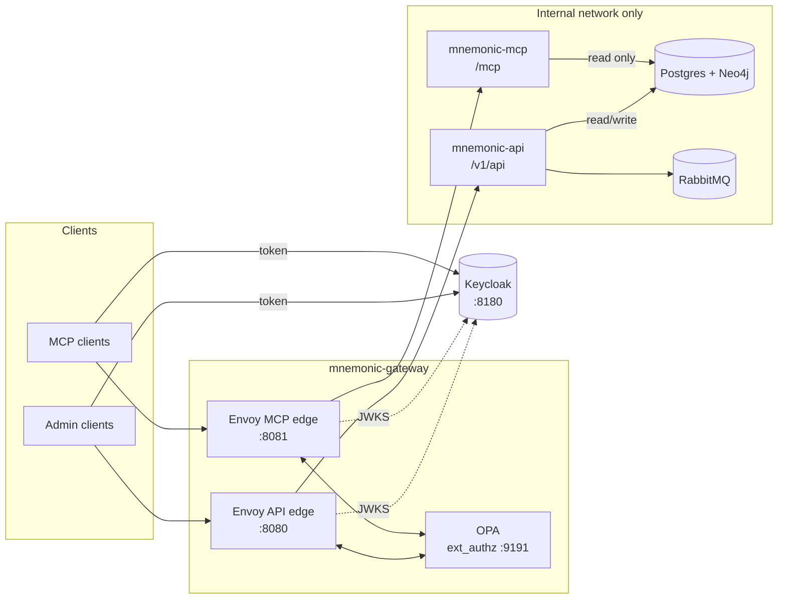

# mnemonic-gateway

Envoy and OPA gateway that handles authentication and authorization for the Mnemonic MCP server and Admin API.

`mnemonic-mcp` and `mnemonic-api` have no auth code by design. Every request reaches them through Envoy, which verifies the caller's token and asks OPA whether the request is allowed.

## How it fits



Each request goes through two checks:

1. **Authentication (Envoy `jwt_authn`).** Verifies the JWT signature against Keycloak's JWKS, plus issuer, expiry and audience. Each edge accepts only its own audience, so an API token is rejected at `/mcp` and the other way round. Envoy strips the token before forwarding.
2. **Authorization (OPA, via Envoy `ext_authz`).** Decides from the verified claims, the method, the path and, on the MCP edge, the `Mcp-Method` and `Mcp-Name` headers.

## Layout

| Path | What it is |
| --- | --- |
| `envoy/envoy.yaml` | Both edges: JWT verification, ext_authz, the MCP 401/403 challenges and protected resource metadata |
| `opa/policy/` | Rego policies (`api.rego`, `mcp.rego`, entry point `main.rego`) and their tests |
| `keycloak/realm-mnemonic.json` | Dev realm: audiences, scopes, test clients and a dev user |
| `docker-compose.yaml` | Full local stack: gateway, Keycloak, both services and their data stores |
| `test/compose.stub.yaml` | The gateway with stub services, for CI and quick runs |
| `test/e2e/` | Go tests of every allow/deny case, run against either stack |

## Access rules

### API edge (`localhost:8080`, audience `mnemonic-api`)

| Request | Needs |
| --- | --- |
| `GET /version` | nothing |
| `GET /health` | any valid token |
| `GET /v1/api/patterns`, `/patterns/search`, `/patterns/{id}`, `/patterns/{id}/chunks` | `patterns:read` |
| `POST /v1/api/patterns`, `PUT /v1/api/patterns/{id}` | `patterns:write` |
| `DELETE /v1/api/patterns/{id}`, `GET /swagger/*` | `patterns:admin` |
| anything else | denied |

Scopes nest: `patterns:admin` includes `patterns:write`, which includes `patterns:read`.

### MCP edge (`localhost:8081`, audience `mnemonic-mcp`)

| Request | Needs |
| --- | --- |
| `initialize`, `ping`, `tools/list`, `notifications/*` | any valid token |
| `tools/call` `search_patterns` | `mcp:search` |
| `tools/call` `get_pattern`, `find_related_patterns` | `mcp:read` |
| `GET` / `DELETE /mcp` | any valid token |
| any other method, tool or path | denied |

Every `POST /mcp` must send `MCP-Protocol-Version: 2026-07-28`. The MCP server only checks that the `Mcp-Method` and `Mcp-Name` headers match the JSON-RPC body from that version on, so for older versions those headers can't be trusted and OPA denies the request. To allow a newer version, add it to `supported_versions` in `opa/policy/mcp.rego` once the server validates headers for it.

Unauthenticated MCP requests get `401` with `WWW-Authenticate: Bearer resource_metadata=...`, and Envoy serves the metadata at `/.well-known/oauth-protected-resource/mcp` (RFC 9728), so MCP clients can discover Keycloak and start OAuth on their own.

## Running it

Requirements: Docker, Go 1.24, and [OPA](https://www.openpolicyagent.org/docs/latest/#running-opa) for the policy tests.

```sh
make test-policy     # opa fmt, check and test
make validate-envoy  # envoy --mode validate
make e2e-stub        # gateway + stub services, run the e2e tests, tear down
```

For the full stack, which pulls the published `latest-dev` images from ghcr.io:

```sh
export MNEMONIC_OPENAI_API_EMBEDDINGS_KEY=...
make up
make e2e
```

To use images you built with `make build` in those repos, point the stack at them:

```sh
MNEMONIC_API_IMAGE=ghcr.io/twistingmercury/mnemonic-api:latest \
MNEMONIC_MCP_IMAGE=ghcr.io/twistingmercury/mnemonic-mcp:latest make up
```

### Getting a token

The dev realm has one service client per role. The secret is the client ID followed by `-secret`.

| Client | Audience | Scopes |
| --- | --- | --- |
| `mcp-agent` | `mnemonic-mcp` | `mcp:read mcp:search` |
| `mcp-limited` | `mnemonic-mcp` | `mcp:read` |
| `api-reader` | `mnemonic-api` | `patterns:read` |
| `api-writer` | `mnemonic-api` | `patterns:write` |
| `api-admin` | `mnemonic-api` | `patterns:admin` |

```sh
TOKEN=$(curl -s localhost:8180/realms/mnemonic/protocol/openid-connect/token \
  -d grant_type=client_credentials -d client_id=api-reader -d client_secret=api-reader-secret | jq -r .access_token)
curl -H "Authorization: Bearer $TOKEN" localhost:8080/v1/api/patterns
```

For interactive MCP clients, the public client `mnemonic-mcp-client` uses authorization code with PKCE and accepts loopback redirect URIs. Sign in as `dev` / `dev`. The Keycloak admin console is at <http://localhost:8180> (`admin` / `admin`).

## Kubernetes (minikube)

The same stack also runs on a local minikube cluster, from the Helm chart in `deploy/helm/mnemonic/`. It gets its own minikube profile, `mnemonic`, and every `kubectl` and `helm` call names that context, so your current context and other clusters are left alone.

Requirements: Docker, minikube, kubectl, Helm 4, `jq`, the locally built `mnemonic-*` images (`latest-dev` for the services, `v1.0.0-dev` for Postgres and Neo4j), and the OpenAI key in `MNEMONIC_OPENAI_API_EMBEDDINGS_KEY`. On Linux, set `fs.inotify.max_user_instances` to at least 512, or kube-proxy can fail with `too many open files`.

```sh
make k8s-up            # profile (Calico CNI), image load, ConfigMaps, Secret, helm upgrade --install --wait
make k8s-forward       # port-forwards in the background
make k8s-test          # end-to-end and isolation checks (real OpenAI calls)
make k8s-forward-stop  # stop the port-forwards
make k8s-down          # uninstall the chart and delete the namespace
make k8s-delete        # delete the whole mnemonic profile
```

`make k8s-up` runs `k8s-cluster`, `k8s-images`, `k8s-config` and `k8s-secret` first. You can also run each one on its own.

`k8s-images` compares each image's build time on the host with the copy in the cluster. If you rebuilt an image under the same tag, it replaces the stale copy and restarts only the workloads that use it; otherwise it reports "up to date". (Plain `minikube image load` keeps the old copy when the tag already exists.)

| Service | URL |
| --- | --- |
| API edge | `localhost:8080` |
| MCP edge | `localhost:8081` |
| Keycloak | `localhost:8180` |

These are the same ports as the compose stack, so the token and `curl` examples above work unchanged. Tokens keep the issuer `http://localhost:8180/realms/mnemonic` (`keycloak.publicUrl` in `values.yaml`). Envoy fetches the JWKS over the in-cluster `keycloak` Service.

The chart doesn't copy any config. `make k8s-config` builds ConfigMaps from `gateway/envoy/envoy.yaml`, `gateway/envoy/envoy-egress.yaml`, `gateway/opa/` and `gateway/keycloak/realm-mnemonic.json`, and the chart mounts them by name. Pods carry a checksum of their ConfigMaps, so after you edit a file, `make k8s-up` restarts the pods that use it. The Service names match the compose service names, so `envoy.yaml` works in both stacks without changes.

**The OpenAI key.** `make k8s-secret` pipes the key into the Secret `mnemonic-openai`. It never shows up as a command-line argument, in a file, or in the chart's values. Only the `egress` pod mounts that Secret. The API, MCP and enricher get the placeholder `proxy-managed` and send their OpenAI calls to `http://egress:8443/v1`. After rotating the key, run `kubectl --context mnemonic -n mnemonic rollout restart deployment/egress`. The dev credentials for Postgres, Neo4j, RabbitMQ and the Keycloak admin are the compose ones, and they're kept in a chart-managed Secret too.

**Isolation.** Calico enforces NetworkPolicies, which minikube's default CNI does not. The namespace denies all ingress and egress by default. Every pod may query kube-dns. Beyond that, these are the only allowed flows:

| From | To |
| --- | --- |
| anywhere (port-forward) | Envoy 8080, 8081 |
| Envoy | OPA 9191, Keycloak 8080, API 8080, MCP 8081 |
| API | Postgres, Neo4j, RabbitMQ, egress |
| MCP | Postgres, Neo4j, egress |
| enricher | Postgres, Neo4j, RabbitMQ, egress |
| egress | the internet on TCP 443, excluding private and link-local ranges |

`make k8s-test` proves the policies hold. It starts short-lived curl pods that carry a component's policy labels, or no labels at all, and checks four things. A pod with the enricher's labels can't reach `api.openai.com`, while one with the egress labels can. A pod with no labels reaches none of the data stores or services. The services can't reach each other. Only the egress pod reaches the internet. Each of these checks comes with a positive control, such as an API-labelled pod reaching Postgres, so a probe that can't connect anywhere never counts as "blocked". To switch the policies off for debugging, run `make k8s-up K8S_HELM_ARGS="--set networkPolicy.enabled=false"`.

The admin UI (`mnemonic-admin`) isn't part of this deployment.

## Dev-only settings

These values are only for local use and need replacing before any shared deployment:

- The issuer and public URLs in `envoy/envoy.yaml` assume `localhost`. Plain HTTP is used throughout.
- The Keycloak realm uses fixed client secrets, a dev user, a broad loopback redirect pattern, and `start-dev` with no persistent database.
- Envoy's admin interface listens on `127.0.0.1:9901` inside the container only.
